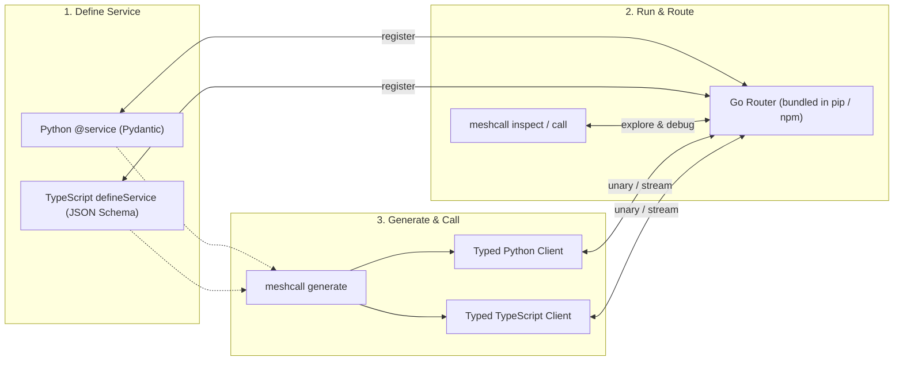

# MeshCall

**English** | [简体中文](README.zh-CN.md)

**Typed, streaming RPC between Python and TypeScript—with a bundled Go Router, zero `.proto` files, and first-class AI Agent tooling.**

Write a Python class with Pydantic models (or a TypeScript service with JSON Schema). MeshCall turns it into a multiplexed WebSocket RPC service with bidirectional backpressure, generates static clients for both languages, routes and load-balances across instances via a stateless Go Router, and lets humans or AI agents inspect and call any live service from the CLI.

---

## Why MeshCall? (What Benefits Does It Bring?)

| Pain Point | Traditional Approach | How MeshCall Solves It |
| --- | --- | --- |
| **Cross-language RPC between Python & TypeScript** | Maintain `.proto` files + `protoc` plugins, or hand-write REST + OpenAPI glue | **Code is the contract.** Write native Python (`Pydantic`) or TypeScript (`JSON Schema`). One command (`meshcall generate`) outputs a typed `uv` or `Yarn`/`npm` client package. |
| **Streaming LLM tokens, progress, or uploads** | SSE hacks, chunked HTTP, or custom WebSocket framing without backpressure | **Native `server_stream` & `client_stream`** over one multiplexed WebSocket connection, with per-call item credit (window of 16), fair scheduling, and instant cancellation on loop break. |
| **Routing, load balancing & stateful workers** | Deploy Nginx/Envoy + Redis/Consul, or build custom worker routing | **Bundled stateless Go Router** (`meshcall-router` ships inside `pip`/`npm`). Supports `round_robin`, `least_inflight`, `sticky`, rolling upgrades, and **instance-targeted calls** (`instance="gpu-worker-2"`). |
| **Production reliability without stateful brokers** | Complex message queues or fragile retry loops | **Built-in stateless reliability:** 3-layer relative deadlines (Server → Router → Client), `max_inflight` backpressure, automatic circuit breaking, `idempotency_key` deduplication/replay, and zero-downtime `drain=True`. |
| **Human & AI Agent developer experience** | Dig through source code or outdated docs to figure out payloads and errors | **Self-describing live mesh:** `meshcall init` equips AI agents in 1 second; `meshcall router inspect` shows live schemas & health; `meshcall call` gives field-level `violations` and repair hints; `MESHCALL_STRICT=1` enforces contract quality at import time. |

---

## How It Works at a Glance



> **Need 1-to-1 local IPC instead of a Router?** Every service and generated client also supports **Direct Mode** over TCP (`ws://127.0.0.1:8765`) or Unix Domain Sockets (`unix_path="/tmp/app.sock"`) without changing a single line of service or client call code.

---

## Documentation Map

| Document | What You'll Learn | 中文版 |
| --- | --- | --- |
| **[User Guide & Cookbook](docs/guide.md)** | **Start here:** Decision tables & copy-paste recipes for streaming, load balancing, targeted stateful workers, retries & idempotency, graceful drain, auth tokens, interceptors, and strict mode | **[快速上手与实战指南](docs/zh-CN/guide.md)** |
| **[Router Architecture](docs/router.md)** | How the Go Router balances calls, handles multi-Router failover, and manages ACL accounts & temporary tokens | [Router 架构与鉴权](docs/zh-CN/router.md) |
| **[Runtime Architecture](docs/architecture.md)** | Python worker-loop isolation, credit flow control, failure boundaries, and contract lint rules (`W001`–`W006`) | [运行时架构设计](docs/zh-CN/architecture.md) |
| **[Protocol Specification (`meshcall/1`)](docs/protocol.md)** | Wire frames, handshake, 3-layer timeout math, liveness pings, and standard error codes | [协议规范 (`meshcall/1`)](docs/zh-CN/protocol.md) |
| **[Python SDK (`meshcall-py`)](meshcall-py/README.md)** | Python package quick reference | [Python SDK 指南](meshcall-py/README.zh-CN.md) |
| **[TypeScript SDK (`meshcall-ts`)](meshcall-ts/README.md)** | TypeScript package quick reference | [TypeScript SDK 指南](meshcall-ts/README.zh-CN.md) |
| **[Go Router & CLI (`meshcall-router`)](meshcall-router/README.md)** | Standalone binary flags, password hashing, and Docker deployment | [Go Router 部署指南](meshcall-router/README.zh-CN.md) |
| **[Contributing](CONTRIBUTING.md)** | Monorepo checks, conformance suite, and release workflow | [贡献指南](CONTRIBUTING.zh-CN.md) |

---

## Install (Zero Go Toolchain Required)

```bash
# Python (3.11+) — bundles meshcall-router & meshcall CLI in platform wheels
uv add meshcall
# or: pip install meshcall

# TypeScript / Node.js (20+) — bundles binaries via meshcall-router-<os>-<cpu>
yarn add meshcall
# or: npm install meshcall
```

**Using an AI Coding Agent (Claude Code, Cursor, Antigravity, Codex)?** Run this once in your project root:

```bash
uv run meshcall init   # or: npx meshcall init
```

This installs `.claude/skills/meshcall/SKILL.md` and adds a concise guide to `AGENTS.md`, teaching your AI agent to inspect live services, read structured validation violations, and write `MESHCALL_STRICT=1`-compliant services automatically.

---

## 5-Minute End-to-End Quickstart (Python ↔ TypeScript)

### Step 1: Write & Start a Service (`service.py`)

In MeshCall, **parameters are the request** and **return types are the response**:
- `@method()` → Unary (`request -> response`)
- `@method.server_stream()` → Server Stream (`request -> AsyncIterator[Item]`)
- `@method.client_stream()` → Client Stream (`RpcInputStream[Item] + params -> response`)
- `ctx: RpcContext` and `logger: RpcLogger` are injected automatically by the server and never appear as client arguments.

```python
import asyncio
from collections.abc import AsyncIterator
from pydantic import BaseModel
from meshcall import (
    RpcContext,
    RpcInputStream,
    RpcLogger,
    RpcServer,
    WebSocketRouter,
    method,
    service,
)
from meshcall.drivers import WebSocketRouterServerDriver


class CountItem(BaseModel):
    value: int


class SumResult(BaseModel):
    total: int


@service("example.v1.CounterService")
class CounterService:
    """Count numbers and aggregate streams."""

    @method(read_only=True)
    async def add(self, left: int, right: int, ctx: RpcContext) -> SumResult:
        """Return the sum of left and right."""
        ctx.set_trailer("handled-by", ctx.instance_id)
        return SumResult(total=left + right)

    @method.server_stream(read_only=True)
    async def count(self, stop: int, logger: RpcLogger) -> AsyncIterator[CountItem]:
        """Stream integers from 0 up to stop - 1."""
        logger.info("counting up to {}", stop)
        for value in range(stop):
            yield CountItem(value=value)

    @method.client_stream(idempotent=True)
    async def sum_stream(
        self,
        items: RpcInputStream[CountItem],
        offset: int = 0,
    ) -> SumResult:
        """Sum a stream of CountItem payloads starting from offset."""
        total = offset
        async for item in items:
            total += item.value
        return SumResult(total=total)


async def main() -> None:
    # Starts the bundled Go Router and registers this Python instance
    async with WebSocketRouter(host="127.0.0.1", port=8765):
        driver = WebSocketRouterServerDriver(
            "ws://127.0.0.1:8765",
            instance_id="counter-py-1",
        )
        server = RpcServer(services=[CounterService()], driver=driver)
        await server.start()
        print("Ready on ws://127.0.0.1:8765")
        await asyncio.Event().wait()


if __name__ == "__main__":
    asyncio.run(main())
```

Run it with strict contract checking enabled:

```bash
MESHCALL_STRICT=1 uv run python service.py
```

### Step 2: Inspect & Call from the Terminal (No Codegen Needed)

Before writing any client code, you (or your AI agent) can inspect the live Router and call any method directly:

```bash
# 1. See all registered services, instance health, and method signatures
uv run meshcall router inspect --router ws://127.0.0.1:8765

# 2. Call a unary method
uv run meshcall call example.v1.CounterService.add '{"left": 20, "right": 22}'

# 3. Call a server stream (streams one JSON line per item)
uv run meshcall call example.v1.CounterService.count '{"stop": 4}'

# 4. Call a client stream (pipe JSON lines via --stdin)
printf '{"value":10}\n{"value":20}\n' | \
  uv run meshcall call example.v1.CounterService.sum_stream '{"offset": 5}' --stdin
```

### Step 3: Generate Typed Clients for Python & TypeScript

```bash
# Generate an installable Python uv package (or add --single-file for one self-contained .py file)
uv run meshcall generate service:CounterService --output generated/counter-py

# Generate a TypeScript package from the exact same Python service
uv run meshcall generate service:CounterService \
  --language typescript \
  --output generated/counter-ts
```

### Step 4: Call with Full Autocomplete & Validation

**From Python:**

```python
from meshcall.drivers import WebSocketClientDriver
from meshcall_example_v1_counterservice_client import CounterServiceClient, CountItem

async with CounterServiceClient(WebSocketClientDriver("ws://127.0.0.1:8765")) as client:
    # Unary
    res = await client.add(20, 22, timeout=5.0)
    print("add:", res.total)  # 42

    # Server stream
    async for item in client.count(4, timeout=5.0):
        print("count:", item.value)

    # Client stream
    stream = await client.sum_stream(offset=5)
    await stream.send(CountItem(value=10))
    await stream.send(CountItem(value=20))
    await stream.close_send()
    total = await stream
    print("sum_stream:", total.total)  # 35
```

**From TypeScript:**

```typescript
import { MeshCallClient } from "meshcall";
import { CounterServiceClient } from "./generated/counter-ts/src/index.js";

const raw = new MeshCallClient("ws://127.0.0.1:8765");
const client = new CounterServiceClient(raw);

try {
  // Unary
  const res = await client.add(20, 22, { timeoutMs: 5_000 });
  console.log("add:", res.total); // 42

  // Server stream (breaking out of for-await cancels the server stream automatically)
  for await (const item of client.count(4, { timeoutMs: 5_000 })) {
    console.log("count:", item.value);
  }
} finally {
  await raw.close();
}
```

---

## Feature Cheat Sheet: Which Option Should I Use?

| Scenario | What to Use | Python Example | TypeScript Example |
| --- | --- | --- | --- |
| **Pure query (safe to auto-retry)** | `read_only` | `@method(read_only=True)` | `unaryMethod({ readOnly: true, ... })` |
| **Safe repeatable mutation** | `idempotent` | `@method(idempotent=True)` | `unaryMethod({ idempotent: true, ... })` |
| **Non-repeatable mutation (e.g., charge, delete)** | `destructive` + `idempotency_key` at call site | `@method(destructive=True)` | `unaryMethod({ destructive: true, ... })` |
| **Distribute load across stateless workers** | Balance policy | `@method(balance=Balance.least_inflight())` | `unaryMethod({ balance: { kind: "least_inflight" }, ... })` |
| **Route by session key (soft affinity)** | Sticky balance | `@method(balance=Balance.sticky("session_id"))` | `unaryMethod({ balance: { kind: "sticky", key: "session_id" }, ... })` |
| **Address a specific stateful worker (GPU / Actor)** | Targeted service / call | `@service("gpu.v1.Worker", targeted=True)` + `client.run(..., instance="gpu-1")` | `defineService({ targeted: true, ... })` + `client.run(..., { instance: "gpu-1" })` |
| **Protect a worker from overload** | `max_inflight` | `RpcServer(..., max_inflight=32)` | `new MeshCallServer({ maxInflight: 32, ... })` |
| **Zero-downtime rolling restart** | Graceful drain | `await server.stop(drain=True, drain_timeout=30)` | `await server.close({ drain: true, drainTimeoutMs: 30_000 })` |
| **High availability across multiple Routers** | Endpoint list | `WebSocketRouterServerDriver(["ws://r1:8765", "ws://r2:8765"])` | `router: { endpoint: ["ws://r1:8765", "ws://r2:8765"] }` |

See the **[User Guide & Cookbook](docs/guide.md)** for complete code recipes covering each scenario.

---

## CLI Cheat Sheet (`meshcall`)

Run via `uv run meshcall …` (Python), `npx meshcall …` (Node.js), or `meshcall …`:

| Command | Purpose |
| --- | --- |
| `meshcall init [DIR] [--force]` | Install `.claude/skills/meshcall/SKILL.md` and `AGENTS.md` instructions for AI agents |
| `meshcall router inspect [--router URL] [SERVICE] [--json]` | Inspect registered services, live instances, in-flight load, circuit breakers, and schemas |
| `meshcall call [--router URL] <svc.method> '<json>' [flags]` | Call unary, server-stream, or client-stream (`--stdin`) methods with contract-aware error hints |
| `meshcall generate <contract.json \| module:Class> --output DIR` | Generate a typed Python (`--language python`) or TypeScript (`--language typescript`) package or `--single-file` |
| `meshcall export <module:Class> --output contract.json` | Export a Python service's portable `.meshcall.json` contract |
| `meshcall router install` / `meshcall router path` | Download release binaries on unbundled platforms / print the active binary path |

---

## Repository Layout & Runnable Demos

```text
meshcall/
├── meshcall-py/     # Python runtime SDK, contract exporter, and pytest suite
├── meshcall-ts/     # TypeScript runtime SDK and node:test suite
├── meshcall-router/ # Standalone Go Router, meshcall CLI, codegen, and conformance suite
├── best-practice/   # Reference app: Python streaming session server + TypeScript interactive CLI
├── demo/            # Self-contained runnable examples
│   ├── quickstart/  # Minimal unary + streaming in Python (uv run demo)
│   ├── showcase/    # Full Python feature showcase (uv run demo)
│   ├── router/      # Load balancing, sticky routing & Router features (uv run demo)
│   ├── py2ts/       # Python service -> generated TypeScript client (uv run demo)
│   └── ts2py/       # TypeScript service -> generated Python client (uv run demo)
├── skills/meshcall/ # Official coding-agent skill installed by `meshcall init`
└── docs/            # English & Simplified Chinese (docs/zh-CN/) documentation
```

Run any demo from the repository root:

```bash
uv run --project demo/quickstart demo
uv run --project demo/showcase demo
uv run --project demo/router demo
uv run --project demo/py2ts demo
uv run --project demo/ts2py demo
```

Or run the full CI check suite locally:

```bash
scripts/check.sh                  # Router build, Go, Conformance, Python, TS, Demos, Drift
scripts/check.sh py demos drift   # Run specific stages
scripts/regenerate.sh             # Regenerate all checked-in demo clients and embedded skill
```

---

## Current Boundaries

- **Wire format**: JSON over WebSocket (`ws://`, `wss://` via reverse proxy, or Unix sockets).
- **Mid-stream migration**: Disconnecting terminates active streams on that connection; clients and Router-mode servers reconnect automatically with exponential backoff, and idempotent unary calls can be retried via `RetryPolicy`.
- **Duplex streaming**: Supported experimentally at the protocol/runtime layer; unary, `server_stream`, and `client_stream` are the stable production shapes.
- **Handler concurrency**: Python handlers run on a dedicated background worker loop so synchronous code cannot block RPC heartbeats/deadlines; TypeScript handlers run on Node's event loop and should stay async.
