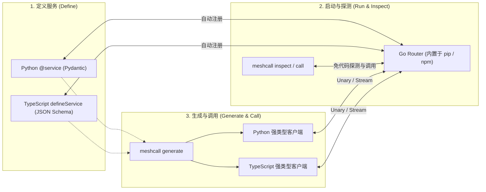

# MeshCall

[English](README.md) | **简体中文**

**面向 Python 与 TypeScript 的强类型流式 RPC 框架——内置 Go 路由器、无需编写 `.proto`、原生为人类开发者与 AI Agent 打造。**

只需用 Python 的 `Pydantic` 模型（或 TypeScript 的 `JSON Schema`）编写普通类与函数，MeshCall 就能将其发布为支持双向背压（Backpressure）的多路复用 WebSocket RPC 服务，一键生成跨语言静态类型客户端包，通过内置的无状态 Go Router 实现负载均衡与实例级路由，并支持直接通过 CLI 探测和调用任何在线服务。

---

## 为什么选择 MeshCall？（它能解决什么痛点？）

| 常见痛点 | 传统方案的局限 | MeshCall 的解决方式与收益 |
| --- | --- | --- |
| **Python 与 TypeScript 跨语言调用繁琐** | 维护 `.proto` 与 `protoc` 工具链，或手写 REST + OpenAPI 胶水代码 | **代码即契约，零 `.proto`。** 直接写 Python（`Pydantic`）或 TS（`JSON Schema`），一条命令 `meshcall generate` 生成带完整类型提示与双端校验的 `uv` / `Yarn` 客户端包。 |
| **大模型流式输出（LLM Token）、长任务进度、流式上传难处理** | 用 SSE 拼凑单向流、手写 WebSocket 分帧，缺乏背压导致内存暴涨 | **原生 `server_stream` 与 `client_stream`。** 单条 WebSocket 连接多路复用，内置 16 条目滑动信用窗口（Credit）背压、公平轮转调度，客户端退出循环自动取消服务端任务。 |
| **多实例扩容、负载均衡与有状态节点寻址复杂** | 需额外部署 Nginx/Envoy + Redis/Consul，或手写 Worker 路由表 | **SDK 内置独立 Go Router**（随 `pip`/`npm` 自动安装，免配 Go 环境）。支持轮询、最少并发、粘性会话、滚动升级，以及**定向实例调用**（`instance="gpu-worker-2"`）。 |
| **生产环境高可用与容错组件碎片化** | 引入笨重的消息队列，或手写脆弱的重试/超时逻辑 | **无状态高可用闭环：** 三层相对超时（Server → Router → Client）、单实例并发上限（`max_inflight`）、自动熔断与半开探测、幂等键（`idempotency_key`）并发合并与结果重放、零中断优雅停机（`drain=True`）。 |
| **人类与 AI 联调时黑盒猜参数** | 翻找源码或过期文档猜测接口格式，报错信息模糊 | **自描述实时网格（AI-Native）：** `meshcall init` 1 秒装配 AI 技能；`meshcall router inspect` 实时查看在线服务契约与健康状态；`meshcall call` 在参数错误时直接给出字段级 `violations` 与修复提示；`MESHCALL_STRICT=1` 在导入期拦截不规范契约。 |

---

## 30 秒看懂核心工作流



> **只需要 1 对 1 本地通信、不想启动 Router？** 所有服务端和生成的客户端都原生支持 **Direct 直连模式**（直接监听 TCP `ws://127.0.0.1:8765` 或 Unix Domain Socket `unix_path="/tmp/app.sock"`），业务代码与客户端调用代码**一行都不用改**。

---

## 文档导航

| 文档 | 你能学到什么 | English |
| --- | --- | --- |
| **[快速上手与实战指南](docs/zh-CN/guide.md)** | **推荐首读：** 场景选型表 + 完整代码范例（流式调用、负载均衡、有状态实例定向调用、重试与幂等、优雅停机、鉴权与临时 Token、拦截器、严格模式） | **[User Guide & Cookbook](docs/guide.md)** |
| **[Router 架构与鉴权](docs/zh-CN/router.md)** | Go Router 路由表机制、多 Router 容灾、账号 ACL 配置与临时范围 Token 签发 | [Router Architecture](docs/router.md) |
| **[运行时架构设计](docs/zh-CN/architecture.md)** | Python 双事件循环隔离、信用窗口流控、故障边界与契约静态检查规则（`W001`–`W006`） | [Runtime Architecture](docs/architecture.md) |
| **[协议规范 (`meshcall/1`)](docs/zh-CN/protocol.md)** | 逻辑帧格式、握手流程、三层超时计算、心跳保活与标准错误码表 | [Protocol Specification](docs/protocol.md) |
| **[Python SDK 指南 (`meshcall-py`)](meshcall-py/README.zh-CN.md)** | Python 包安装与核心 API 速查 | [Python SDK](meshcall-py/README.md) |
| **[TypeScript SDK 指南 (`meshcall-ts`)](meshcall-ts/README.zh-CN.md)** | TypeScript 包安装与核心 API 速查 | [TypeScript SDK](meshcall-ts/README.md) |
| **[Go Router 部署指南 (`meshcall-router`)](meshcall-router/README.zh-CN.md)** | 独立二进制启动参数、密码哈希生成与 Docker 部署 | [Go Router & CLI](meshcall-router/README.md) |
| **[贡献指南](CONTRIBUTING.zh-CN.md)** | 仓库本地开发检查、协议一致性测试套件与发版流程 | [Contributing](CONTRIBUTING.md) |

---

## 安装（无需安装 Go 工具链）

```bash
# Python (3.11+) —— 平台 Wheel 已内置预编译的 meshcall-router 与 meshcall CLI
uv add meshcall
# 或: pip install meshcall

# TypeScript / Node.js (20+) —— 通过可选依赖自动安装对应平台的二进制包
yarn add meshcall
# 或: npm install meshcall
```

**正在使用 AI 编程助手（Claude Code、Cursor、Antigravity、Codex）？** 在你的项目根目录执行一次：

```bash
uv run meshcall init   # 或: npx meshcall init
```

该命令会自动安装 `.claude/skills/meshcall/SKILL.md` 并在 `AGENTS.md` 中注入使用规范，让 AI 自动学会用 `meshcall router inspect` 探测服务、用 `meshcall call` 调试接口，并在 `MESHCALL_STRICT=1` 严格模式下编写高质量服务契约。

---

## 5 分钟端到端快速上手（Python ↔ TypeScript）

### 第一步：编写并启动服务 (`service.py`)

在 MeshCall 中，**函数参数就是请求字段**，**返回值类型就是响应模型**：
- `@method()` → 一元调用（`参数 -> 响应模型`）
- `@method.server_stream()` → 服务端流（`参数 -> AsyncIterator[条目模型]`）
- `@method.client_stream()` → 客户端流（`RpcInputStream[条目模型] + 参数 -> 响应模型`）
- `ctx: RpcContext` 与 `logger: RpcLogger` 由服务端按调用自动注入，不会出现在客户端参数中。

```python
import asyncio
from collections.abc import AsyncIterator
from pydantic import BaseModel
from meshcall import (
    RpcContext,
    RpcInputStream,
    RpcLogger,
    RpcServer,
    WebSocketRouter,
    method,
    service,
)
from meshcall.drivers import WebSocketRouterServerDriver


class CountItem(BaseModel):
    value: int


class SumResult(BaseModel):
    total: int


@service("example.v1.CounterService")
class CounterService:
    """提供整数计数与流式求和。"""

    @method(read_only=True)
    async def add(self, left: int, right: int, ctx: RpcContext) -> SumResult:
        """返回 left 与 right 的和。"""
        ctx.set_trailer("handled-by", ctx.instance_id)
        return SumResult(total=left + right)

    @method.server_stream(read_only=True)
    async def count(self, stop: int, logger: RpcLogger) -> AsyncIterator[CountItem]:
        """依次流式返回从 0 到 stop - 1 的整数。"""
        logger.info("counting up to {}", stop)
        for value in range(stop):
            yield CountItem(value=value)

    @method.client_stream(idempotent=True)
    async def sum_stream(
        self,
        items: RpcInputStream[CountItem],
        offset: int = 0,
    ) -> SumResult:
        """以 offset 为初始值，累加客户端发送的整数流。"""
        total = offset
        async for item in items:
            total += item.value
        return SumResult(total=total)


async def main() -> None:
    # 启动内置的 Go Router 并注册当前 Python 服务实例
    async with WebSocketRouter(host="127.0.0.1", port=8765):
        driver = WebSocketRouterServerDriver(
            "ws://127.0.0.1:8765",
            instance_id="counter-py-1",
        )
        server = RpcServer(services=[CounterService()], driver=driver)
        await server.start()
        print("Ready on ws://127.0.0.1:8765")
        await asyncio.Event().wait()


if __name__ == "__main__":
    asyncio.run(main())
```

开启严格模式启动服务（自动检查 docstring 与方法读写注解）：

```bash
MESHCALL_STRICT=1 uv run python service.py
```

### 第二步：使用 CLI 探测与直接调用（无需写客户端代码）

打开第二个终端，无需生成任何代码即可查看实时注册表并调用任意方法：

```bash
# 1. 查看所有在线服务、实例健康状态与方法签名
uv run meshcall router inspect --router ws://127.0.0.1:8765

# 2. 调用一元方法
uv run meshcall call example.v1.CounterService.add '{"left": 20, "right": 22}'

# 3. 调用服务端流方法（每收到一个条目输出一行 JSON）
uv run meshcall call example.v1.CounterService.count '{"stop": 4}'

# 4. 调用客户端流方法（通过 --stdin 管道输入 JSON 行）
printf '{"value":10}\n{"value":20}\n' | \
  uv run meshcall call example.v1.CounterService.sum_stream '{"offset": 5}' --stdin
```

### 第三步：生成 Python 与 TypeScript 强类型客户端

```bash
# 生成可安装的 Python uv 客户端包（加 --single-file 可生成单文件 .py）
uv run meshcall generate service:CounterService --output generated/counter-py

# 从同一个 Python 服务直接生成 TypeScript 客户端包
uv run meshcall generate service:CounterService \
  --language typescript \
  --output generated/counter-ts
```

### 第四步：在代码中享受完整类型补全与校验

**Python 调用端：**

```python
from meshcall.drivers import WebSocketClientDriver
from meshcall_example_v1_counterservice_client import CounterServiceClient, CountItem

async with CounterServiceClient(WebSocketClientDriver("ws://127.0.0.1:8765")) as client:
    # 1. 一元调用
    res = await client.add(20, 22, timeout=5.0)
    print("add:", res.total)  # 42

    # 2. 服务端流
    async for item in client.count(4, timeout=5.0):
        print("count:", item.value)

    # 3. 客户端流
    stream = await client.sum_stream(offset=5)
    await stream.send(CountItem(value=10))
    await stream.send(CountItem(value=20))
    await stream.close_send()
    total = await stream
    print("sum_stream:", total.total)  # 35
```

**TypeScript 调用端：**

```typescript
import { MeshCallClient } from "meshcall";
import { CounterServiceClient } from "./generated/counter-ts/src/index.js";

const raw = new MeshCallClient("ws://127.0.0.1:8765");
const client = new CounterServiceClient(raw);

try {
  // 1. 一元调用
  const res = await client.add(20, 22, { timeoutMs: 5_000 });
  console.log("add:", res.total); // 42

  // 2. 服务端流（提前 break 退出 for-await 会自动通知服务端取消流）
  for await (const item of client.count(4, { timeoutMs: 5_000 })) {
    console.log("count:", item.value);
  }
} finally {
  await raw.close();
}
```

---

## 核心特性选型速查表（我该用哪个配置？）

| 你的业务场景 | 推荐配置 | Python 写法 | TypeScript 写法 |
| --- | --- | --- | --- |
| **纯查询接口（允许断线自动重试）** | `read_only` | `@method(read_only=True)` | `unaryMethod({ readOnly: true, ... })` |
| **可安全重复执行的写入（如按 ID 覆盖保存）** | `idempotent` | `@method(idempotent=True)` | `unaryMethod({ idempotent: true, ... })` |
| **不可重复的变更（如扣款、创建订单、删除）** | `destructive` + 调用时传 `idempotency_key` | `@method(destructive=True)` | `unaryMethod({ destructive: true, ... })` |
| **把请求均匀分发给最空闲的无状态节点** | 最少并发负载均衡 | `@method(balance=Balance.least_inflight())` | `unaryMethod({ balance: { kind: "least_inflight" }, ... })` |
| **按会话 ID 优先路由到同一节点（软亲和）** | 粘性哈希负载均衡 | `@method(balance=Balance.sticky("session_id"))` | `unaryMethod({ balance: { kind: "sticky", key: "session_id" }, ... })` |
| **点名调用特定有状态节点（如已加载某模型的 GPU 节点）** | 定向服务（Targeted） | `@service("gpu.v1.Worker", targeted=True)` + `client.run(..., instance="gpu-1")` | `defineService({ targeted: true, ... })` + `client.run(..., { instance: "gpu-1" })` |
| **防止慢节点/GPU 节点被并发请求打满** | `max_inflight` 并发上限 | `RpcServer(..., max_inflight=32)` | `new MeshCallServer({ maxInflight: 32, ... })` |
| **发版/重启时不中断任何正在执行的请求** | 优雅排空（Drain） | `await server.stop(drain=True, drain_timeout=30)` | `await server.close({ drain: true, drainTimeoutMs: 30_000 })` |
| **多 Router 节点高可用容灾（无状态双活）** | 多端点列表 | `WebSocketRouterServerDriver(["ws://r1:8765", "ws://r2:8765"])` | `router: { endpoint: ["ws://r1:8765", "ws://r2:8765"] }` |

完整代码范例请查阅 **[快速上手与实战指南](docs/zh-CN/guide.md)**。

---

## CLI 命令速查表 (`meshcall`)

在 Python 项目中使用 `uv run meshcall …`，在 Node.js 项目中使用 `npx meshcall …`（若二进制在 `PATH` 中也可直接运行 `meshcall …`）：

| 命令 | 用途 |
| --- | --- |
| `meshcall init [DIR] [--force]` | 安装 `.claude/skills/meshcall/SKILL.md` 与 `AGENTS.md` AI 助手规范 |
| `meshcall router inspect [--router URL] [SERVICE] [--json]` | 查看 Router 中已注册的服务、在线实例、当前并发数、熔断状态与完整契约 |
| `meshcall call [--router URL] <svc.method> '<json>' [flags]` | 从终端直接调用一元、服务端流或客户端流（`--stdin`）方法，报错时附带契约级修复建议 |
| `meshcall generate <contract.json \| module:Class> --output DIR` | 生成 Python（`--language python`）或 TypeScript（`--language typescript`）客户端包或单文件（`--single-file`） |
| `meshcall export <module:Class> --output contract.json` | 将 Python 服务导出为跨语言通用的 `.meshcall.json` 契约文件 |
| `meshcall router install` / `meshcall router path` | 在未预打包的平台上下载对应版本二进制 / 查看当前使用的二进制路径 |

---

## 仓库目录结构与可运行示例

```text
meshcall/
├── meshcall-py/     # Python 运行时 SDK、契约导出器与 pytest 测试套件
├── meshcall-ts/     # TypeScript 运行时 SDK 与 node:test 测试套件
├── meshcall-router/ # 独立 Go Router、meshcall CLI、代码生成器与一致性测试套件
├── best-practice/   # 综合实战参考工程：Python 流式会话服务端 + TypeScript 交互式 CLI
├── demo/            # 独立可运行的示例工程
│   ├── quickstart/  # Python 最小化入门示例 (uv run demo)
│   ├── showcase/    # Python 全特性展示 (uv run demo)
│   ├── router/      # 负载均衡、粘性会话与 Router 特性展示 (uv run demo)
│   ├── py2ts/       # Python 服务端 -> 生成 TypeScript 客户端调用 (uv run demo)
│   └── ts2py/       # TypeScript 服务端 -> 生成 Python 客户端调用 (uv run demo)
├── skills/meshcall/ # `meshcall init` 安装的官方 AI Agent 技能源文件
└── docs/            # 英文与简体中文 (docs/zh-CN/) 完整技术文档
```

在仓库根目录直接运行示例：

```bash
uv run --project demo/quickstart demo
uv run --project demo/showcase demo
uv run --project demo/router demo
uv run --project demo/py2ts demo
uv run --project demo/ts2py demo
```

运行与 CI 完全一致的全量本地检查：

```bash
scripts/check.sh                  # 编译 Router、Go 测试、Conformance、Python、TS、示例、防漂移检查
scripts/check.sh py demos drift   # 按需运行指定检查阶段
scripts/regenerate.sh             # 重新生成所有示例客户端与内嵌 Skill
```

---

## 当前边界说明

- **传输编码**：当前版本基于 WebSocket（支持 `ws://`、反向代理 `wss://` 或 Unix Socket）传输 JSON 帧。
- **流中断处理**：连接断开会立即终止该连接上未完成的调用；客户端和 Router 模式服务端会按指数退避自动重连，幂等的一元调用可通过 `RetryPolicy` 自动重试，但流式调用不支持跨连接断点续传。
- **双向流（Duplex）**：协议层与运行时已支持实验性的 `duplex` 双向流；生产环境推荐使用稳定的一元（`unary`）、服务端流（`server_stream`）和客户端流（`client_stream`）。
- **并发执行模型**：Python 服务端拥有独立的后台业务事件循环线程（Service Worker Loop），同步耗时代码不会阻塞底层 RPC 心跳与超时控制；TypeScript 服务端运行在 Node.js 主事件循环上，请保持 Handler 异步非阻塞。
