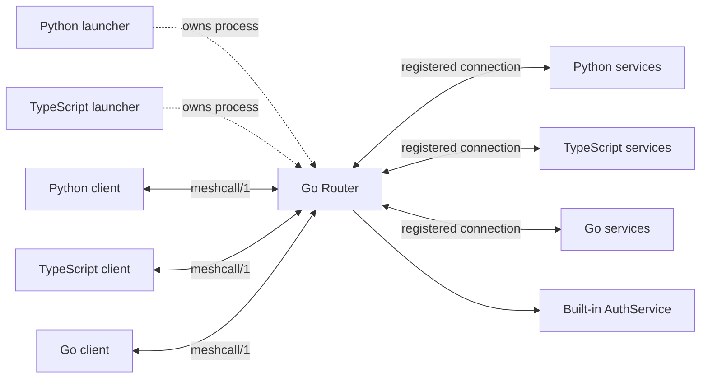

# Router architecture

**English** | [简体中文](zh-CN/router.md)

MeshCall has one Router implementation: the standalone `meshcall-router` Go
executable. Python and TypeScript `WebSocketRouter` APIs launch, supervise, and
stop that same executable. They do not maintain routing tables or run Go through
an FFI layer. A deployed Router can also run independently of any language.
Go services and clients (`meshcall-go`) connect to it the same way; the Go
runtime has no launcher, so a Go program runs `meshcall-router` itself or
connects to a deployed one.



Choose one launcher, or launch the binary directly. Clients and services initiate
WebSocket connections to the Router. TCP and the local transport (a Unix socket,
or a named pipe on Windows) carry the same logical frames. See [building and deploying the executable](../meshcall-router/README.md).

## Registration and routing

1. The HTTP upgrade authenticates an account or temporary token when an auth
   file is configured. The following `hello` declares a protocol and a `client`
   or `server` role; the authenticated identity must permit that role.
2. A service sends `server.register` with its instance ID, service names, method
   names, call shapes, and balancing policies. The Router rejects duplicate
   instance IDs, unauthorized services, and conflicting registrations under
   the same service name: a method already registered with a different
   stream shape or balance policy, or a different `targeted` flag. Instances
   may register *supersets* of each other's methods; a call is balanced over
   the instances that registered its method, so a rolling upgrade adds a
   method on new instances first and old ones keep serving the rest.
   `meshcall.router.` is reserved for built-in services.
3. A client sends `call.open` with a service, method, globally unique call ID,
   request payload, optional `timeout_ms` / `idle_timeout_ms`, and optional
   `metadata`. The Router forwards the frame byte-for-byte, so metadata and any
   fields it does not understand reach the instance unchanged.
4. The Router checks service/method permissions, then selects one instance and records the client connection and service
   instance under the call ID. Every subsequent stream item, window, half-close,
   cancellation, result, and error follows that route.
5. A terminal result or error removes the route and decrements the instance's
   inflight count exactly once. A `call.cancel` from the client also removes the
   route immediately: the cancel is forwarded, but any later frame from the
   instance for that call is dropped.

The Router keeps four in-memory tables: clients, service instances, service
pools, and active call routes. It does not persist state or consult an external
service-discovery system. A pool's method set is the union of its live
instances' registrations and shrinks when instances leave; the Registry
serves the widest contract it has seen and lists, per method, the instances
serving it (`router inspect` prints `on: …` when that is a subset).
Registration compares method shapes and balancing policies; it does not
compare payload JSON Schemas or prove schema compatibility. Payload
validation happens at the service and applicable client runtimes.

## Balancing

| Policy | Selection |
| --- | --- |
| `round_robin` | Advances a cursor per service method through sorted instance IDs |
| `least_inflight` | Chooses the instance with the fewest active calls; instance ID breaks ties |
| `random` | Chooses a random registered instance |
| `sticky` | Hashes a declared request field, such as `request.session_id`, to an instance (rendezvous hashing) |
| `disabled` | Requires exactly one registered instance |

Streams balance only when they open. An active stream never switches instances.
Sticky selection uses rendezvous (highest-random-weight) hashing over the
instance ids: when an instance joins or leaves, only the keys it wins or held
move, and every other key keeps its instance. Inflight counts are
per instance, across its registered services.

A `call.open` that carries `instance_id` bypasses the policy and goes to that
instance: `unavailable` / `instance_unknown` when it is not registered for
the service, `unavailable` / `instance_draining` while it drains,
`resource_exhausted` / `overloaded` at its cap; the circuit breaker is not
consulted because the caller chose the instance by name. A service registered
with `targeted: true` (Python `@service(..., targeted=True)`, TypeScript
`@service(name, { targeted: true, … })`) refuses untargeted calls with
`invalid_argument` / `instance_required` before routing; all its instances
must agree on the flag. `router inspect` marks such services `[targeted]`
and `meshcall call … --instance ID` addresses one.

## Connections and failures

- An instance that sends `server.drain` leaves every pool immediately and is
  acknowledged; calls already routed to it finish normally. Python
  `RpcServer.stop(drain=True)` and TypeScript `server.close({ drain: true })`
  do this before disconnecting, so a rolling restart fails no request.
- Instances may register `max_inflight`; the Router routes around full
  instances and answers `resource_exhausted` / `overloaded` when all are full.
  A per-instance circuit breaker (`--breaker-threshold`, default 5
  consecutive failures; `--breaker-cooldown`, default 10 s) excludes an
  instance that keeps timing out or answering `internal`/`unavailable`, then
  admits one probe call. `Snapshot()` reports in-flight, cap and breaker state.
- Unary calls carrying an `idempotency_key` are deduplicated per `(service,
  method, key, instance_id)` (the last empty for an untargeted call):
  concurrent duplicates join the in-flight call, later duplicates replay the
  cached terminal frame for 60 s (bounded to 4,096 entries; the cache is lost
  on restart, which is safe). After `instance_lost`, the next call with the
  same key prefers another instance.
- A disconnected client causes the Router to cancel its active service calls.
- A disconnected service instance causes its active client calls to fail with
  retryable `unavailable`; the caller decides whether a new call is appropriate.
- Deadlines are enforced in three layers (see [the protocol](protocol.md#timeouts)).
  The Router keeps one timer heap over all routed calls that carry `timeout_ms`
  and fires at `timeout_ms + --deadline-grace` (default 500 ms). When it fires,
  the client receives `deadline_exceeded` with `details.source = "router"`, the
  instance receives `call.cancel` with reason `deadline_exceeded`, and the route
  is freed. This protects clients from an instance that stopped responding
  without closing its connection. The service's own, earlier deadline is still
  the normal path. The Router does not enforce `idle_timeout_ms`.
- The Router never sends `ping`; it answers pings and closes any connection that
  has sent nothing for `--idle-timeout` (default 45 s). Clients and service
  instances ping every 15 s by default, so a healthy peer is never idle that
  long. Services enforce running-call deadlines and stream credit; the Router
  executes only its own management methods and never buffers an entire
  business stream.
- Each connection may have `--max-calls-per-connection` calls in flight
  (default 1000, `0` for no limit); a further `call.open` fails with
  retryable `resource_exhausted` / `overloaded` and the connection stays
  open. Joining an in-flight idempotent call counts as a call.
- SIGTERM or SIGINT drains the Router before it exits (see
  [Router shutdown](protocol.md#router-shutdown)): `/readyz` answers 503, new
  connections get HTTP 503 and new calls `unavailable` / `router_draining`,
  idle connections close with 1001 at once and busy ones when their last call
  ends, and after `--shutdown-timeout` (default 10 s, `0` for none) the calls
  still in flight end with `unavailable` / `router_shutdown` and the instance
  receives `call.cancel`. A second signal skips the wait. A Router owned by
  the Python or TypeScript launcher, which closes its stdin to stop it, ends
  the calls in flight at once. Embedding Go programs call `Shutdown()` or
  `Close()`.
- Restarting the Router loses its registrations and active routes. Version 1
  provides no automatic call replay, stream resumption, route migration, or
  replicated Router state; streams that a restart ends fail with a retryable
  error, so subscriptions resume from their cursor.

## High availability without Router state

Run several independent Routers. A service instance registers with each of
them (Python `WebSocketRouterServerDriver([uri1, uri2])`, TypeScript
`router: { endpoint: [uri1, uri2] }`), keeping one registration per Router
with its own reconnect loop; `start()` succeeds once any Router accepts.
Clients take the same list (`WebSocketClientDriver([uri1, uri2])`,
`new MeshCallClient([uri1, uri2])`): they use one Router and move to the next
when it fails, resuming from the last good one. Because every Router sees
every instance and holds no state that peers cannot rebuild, no coordination
between Routers is needed. Balancing, deduplication and circuit breaking are
per Router: a duplicate idempotent call sent to two different Routers may
execute twice, which handlers that honour the key tolerate.

The Router is a single process responsible for registration, authorization and
forwarding. Each peer has a queue bounded by bytes: `--outbox-size` (default
256 MiB; launcher option `outbox_size` / `outboxSize`; it must be at least
`--max-frame-size`, default and maximum 64 MiB), counting every frame's
encoded size plus a fixed per-frame overhead. There is no frame-count limit:
the Router forwards a stream item only within the credit its consumer granted
on that call (an item beyond it fails the call with `protocol_error`, reason
`flow_control_violation`), so many concurrent streams to one peer are bounded
by that peer's own grants. A peer that stops reading while what it asked for
exceeds the budget is disconnected rather than allowed to accumulate unlimited
buffered data. Per-call FIFO ordering prevents control frames from overtaking
`call.open`; eligible control frames take priority, and other calls rotate
fairly.

## Accounts and permissions

Pass `--auth-file /path/router-auth.json`, Python `auth_file=...`, or TypeScript
`authFile: ...`; or set `MESHCALL_ROUTER_AUTH_FILE` to the path, or
`MESHCALL_ROUTER_AUTH` to the document itself (one of the two; both is an
error). A configured file must contain at least one valid user; malformed
or empty configuration fails startup. Omitting the file enables development
mode. Development mode does not expose token issuance. Every other flag has
a `MESHCALL_ROUTER_<FLAG>` variable as well; see
[the Router README](../meshcall-router/README.md#environment-variables).

```json
{
  "users": [
    {
      "username": "app",
      "password_hash": "REPLACE_WITH_HASH_PASSWORD_OUTPUT",
      "roles": ["client"],
      "call": [
        "chat.v1.ChatService/send",
        "chat.v1.ChatService/history",
        "meshcall.router.v1.AuthService/issue_token",
        "meshcall.router.v1.AuthService/revoke_token"
      ]
    },
    {
      "username": "worker",
      "password_hash": "REPLACE_WITH_HASH_PASSWORD_OUTPUT",
      "roles": ["server"],
      "register": ["chat.v1.ChatService"]
    }
  ]
}
```

Generate each password hash with `meshcall-router hash-password`, as described in
[the CLI README](../meshcall-router/README.md). Hashes use PBKDF2-HMAC-SHA256 with
600,000 iterations and a random 16-byte salt. Plaintext passwords are not stored
in the Router configuration. Configuration is loaded once at startup; restart
the Router to change accounts or their permissions.

`roles` permits `client`, `server`, or both. `register` contains exact service
names; `call` contains `service/method` rules. `service/*` grants every method
on one service; `*` grants all entries in that permission list. Missing lists
grant nothing. The two lists remain independent: permission to call a service
does not imply permission to register an instance of it.

Accounts use HTTP Basic authentication; temporary tokens (`mt_…`) and API keys
(`mk_…`) use HTTP Bearer authentication. Credentials are sent in the
`Authorization` header of the WebSocket upgrade or HTTP request, not in URL
query strings or `hello` payloads.

**Authenticate at connect, authorise at call.** A connection or HTTP request
without any `Authorization` header is the reserved user `anonymous`; it is
not refused. Credentials that are presented but invalid (wrong password,
unknown or expired token, wrong key) are refused with HTTP 401 before the
upgrade and are never downgraded to anonymous. A disallowed role or
registration closes the WebSocket with policy status 1008. Every call the
identity may not make is `permission_denied` (HTTP 403 over HTTP), whether
or not the target exists and whether or not the caller is anonymous, so
calls cannot be used to discover services. Every subsequent frame must
belong to the original client/instance and have a direction appropriate for
its role.

**The `anonymous` user** is an ordinary entry with a reserved name. It takes
no `password_hash`, its `roles` must be `["client"]`, it has no `register`
list and it cannot issue tokens; anything else fails startup. Without the
entry, anonymous callers may connect but every call is refused. Only the
auth file decides what anonymous callers may do; services cannot declare
themselves public.

```json
{ "users": [
  { "username": "anonymous", "roles": ["client"], "call": ["status.v1.Health/*"] }
] }
```

`--max-anonymous-connections` (default 1000) caps anonymous WebSocket
connections inside `--max-connections`, so anonymous load cannot lock out
credentialed clients and services.

**API keys** are long-lived credentials for machine callers (webhooks,
external services). `meshcall-router new-api-key ID` prints a key once and
the entry to add under `api_keys` (fill in `call`):

```json
{ "api_keys": [
  { "id": "ci-bot", "key_hash": "08bd…", "roles": ["client"], "call": ["build.v1.Jobs/*"] }
] }
```

Keys are 256-bit random strings stored as SHA-256 digests, so checking one
is a single hash lookup (unlike a password, which is verified with PBKDF2).
They are configuration, so they survive Router restarts; rotate by adding a
new key and removing the old one. Like temporary tokens, API keys cannot
issue tokens.

A successful Basic check is cached in memory for a minute (keyed by a digest
of the credentials; failures are not cached), so repeated calls from the
same account do not pay for PBKDF2 each time. The cache is lost harmlessly
on restart. Frequent HTTP callers should still prefer API keys or tokens.

Python requires websockets 16.1+ so cross-origin redirects strip authentication
headers; see the [upstream changelog](https://websockets.readthedocs.io/en/stable/project/changelog.html).
Node clients do not follow redirects by default.

Use `wss://` through a TLS reverse proxy across a network. The Go listener does
not terminate TLS itself. The same checks apply to Unix sockets and named
pipes; a named pipe admits only the Router's own user, SYSTEM and
Administrators, as a Unix socket's file mode does. Browsers cannot set the
`Authorization` header on a WebSocket, so they call over HTTP with
`meshcall/web` (`new Mesh(new Router("https://…"), { token })`, see [HTTP calls](#http-calls)). JWT and
an external login system are outside this version. WebSocket clients and
`LocalRouter` subprocess launchers run in Python, Node and Go.

## HTTP calls

The same listener serves HTTP under `/v1/` (full mapping in
[the protocol](protocol.md#http-calls)). Each request is handled as a
short-lived client connection inside the Router, so it passes the same
permission checks, balancing, deadlines, breakers, deduplication and
targeting as a WebSocket call, and the Router keeps nothing once the request
ends; closing the request cancels the call.

```bash
curl http://127.0.0.1:8765/v1/call/demo.v1.Counter/add -d '{"a": 1, "b": 2}'
curl -N http://127.0.0.1:8765/v1/call/demo.v1.Counter/count -d '{"n": 5}'   # {"item":…} lines, then {"end":…}
curl http://127.0.0.1:8765/v1/openapi.json                                    # OpenAPI 3.1 for what you may call
printf '{"offset":0}\n{"value":1}\n{"value":2}\n' | \
  curl http://127.0.0.1:8765/v1/call/demo.v1.Sum/sum -H 'Content-Type: application/x-ndjson' --data-binary @-
meshcall call demo.v1.Counter.add '{"a": 1, "b": 2}' --http   # the CLI over HTTP
```

Authentication is the account or token mechanism above, sent with every
request (`Authorization: Basic …` or `Bearer …`); failures are JSON errors.
Prefer API keys or tokens for frequent HTTP callers: a token is a single
hash lookup, while a Basic password is verified with PBKDF2 whenever the
one-minute success cache above misses, and at most 8 such verifications run
at once (the rest get `503`). Duplex methods answer `405`. Behind a reverse proxy, turn off request buffering for client streams
and response buffering for server streams (nginx: `proxy_request_buffering
off`, `proxy_buffering off`); the Router sends `X-Accel-Buffering: no` on
streaming responses. HTTP calls have their own limits:
`--http-default-timeout` (30 s, unary and client streams without a
`MeshCall-Timeout-Ms`), `--http-max-timeout` (no maximum by default) and
`--http-max-inflight` (10000; more get `429`). Browsers on other origins
need `--http-cors-origin https://app.example` (repeatable). `/healthz` and
`/readyz` serve liveness and readiness probes.

## Metrics

`--metrics-listen ADDR` (`MESHCALL_ROUTER_METRICS_LISTEN`) serves Prometheus
text at `http://ADDR/metrics`. It is off by default and always a separate
listener: the labels name services, methods and instances, which the public
port does not reveal to callers without Registry access. `router.ready`
reports the bound address as `metrics`.

| Metric | Type | Labels |
| --- | --- | --- |
| `meshcall_router_calls_total` | counter | `service`, `method`, `code` (`ok` or the error code) |
| `meshcall_router_call_duration_seconds` | histogram | `service`, `method` |
| `meshcall_router_connections` | gauge | `role` (`client`, `server`) |
| `meshcall_router_anonymous_connections` | gauge | |
| `meshcall_router_http_inflight` | gauge | |
| `meshcall_router_routes` | gauge | |
| `meshcall_router_instance_inflight` | gauge | `service`, `instance` |
| `meshcall_router_instance_breaker_open` | gauge | `service`, `instance` |
| `meshcall_router_outbox_drops_total` | counter | |

Calls are counted when they end: answered by the instance, cancelled by the
client, cut by the Router's deadline, or lost with their instance; calls the
Router refuses at `call.open` are counted with the refusal's code. A call to
a service or method nobody registered is counted with empty `service` and
`method`, so callers cannot create label values. Durations run from the
Router seeing `call.open` to the terminal frame. Everything resets with the
process.

## Registry and the `meshcall` CLI

The Router keeps the contract each instance registers and serves it through
`meshcall.router.v1.Registry`: `list` returns every service with its
instances (in-flight, cap, breaker, draining) and methods (shape,
description, annotations, parameters); `describe {service}` adds the full
contract entry. Both work without an account in development mode; with
accounts they need `meshcall.router.v1.Registry/*` in `call`, and they show
only what the caller may call: a service appears only if the caller may call
at least one of its methods, and only those methods and their contract
entries are listed. Describing a service the caller may not call returns the
same error as describing one that does not exist, and a call to a method the
caller may not call is `permission_denied` whether or not it exists, so
neither can be used to discover services.

The `meshcall` command (built from `cmd/meshcall`, shipped next to
`meshcall-router`) is the human and agent front end to it:

```bash
meshcall --router ws://127.0.0.1:8765 router inspect            # everything
meshcall router inspect chat.v1.Chat --json                      # one service, with contract
meshcall call chat.v1.Chat.send '{"session_id":"s1","text":"hi"}' --metadata trace=abc
meshcall call demo.v1.Counter.count '{"n":5}'                    # server stream: one JSON line per item
printf '{"value":1}\n{"value":2}\n' | meshcall call demo.v1.Sum.sum '{}' --stdin
```

`meshcall init [dir] [--agent universal|claude|cursor|copilot|windsurf|all]
[--force]` (also `uv run meshcall init`, `npx meshcall init`) installs the
first-party skill so coding agents in that project use these commands. By
default (`universal`) it writes `.agents/skills/meshcall/SKILL.md` and a
marked MeshCall section in `AGENTS.md`. `--agent` (repeatable or
comma-separated) writes the named agents' files instead: `claude`
`.claude/skills/meshcall/SKILL.md` + `CLAUDE.md`; `cursor`
`.cursor/rules/meshcall.mdc` + `AGENTS.md`; `copilot`
`.github/skills/meshcall/SKILL.md` + `.github/copilot-instructions.md`;
`windsurf` `.windsurf/rules/meshcall.md` + `AGENTS.md`; `all` every one.
Re-running is idempotent; an edited skill file is kept unless `--force`.

`meshcall generate <contract.json | module:Class> --output PATH
[--language python|typescript|go] [--single-file] [--service NAME]
[--package-name N] [--package-version V] [--class-name N]
[--runtime-import M] [--runtime-version V] [--meshcall-requirement R]`
writes a typed client package (or one file). Go output is always one file,
`PATH` if it ends in `.go`, else `PATH/client.go`, in package
`--package-name` (default: the last name segment, lower-cased, plus
`client`: `demo.v1.Greeting` → `greetingclient`);
`meshcall export module:Class --output contract.json` writes a Python
service's contract (Go services write theirs with `meshcall.WriteContract`,
TypeScript ones with `writeContract`). A `module:Class` source is exported through the interpreter in `MESHCALL_PYTHON`, which
`uv run meshcall` sets to the project's own.

Errors print the code, message, `details` and a hint: an unknown method
lists the available ones, `invalid_argument` shows the request shape from the
contract, `unavailable` points at `router inspect`. `--json` makes every
output one JSON document per line, failures included (on stderr, with the
same `code` / `message` / `details` / `hint` fields).

## Built-in RPC service and temporary tokens

`meshcall.router.v1.AuthService` is implemented in Go and uses the same unary
`call.open` / `call.result` / `call.error` protocol as business services.

| Method | Request | Permission |
| --- | --- | --- |
| `whoami` | `{}` | Any authenticated client identity, including a temporary token |
| `issue_token` | `ttl_seconds`, `scopes` | Account with the method in its `call` ACL |
| `revoke_token` | `token_id` | Account with the method in its `call` ACL; only its own tokens |

An issuance request can grant one service or several explicitly named services:

```json
{
  "ttl_seconds": 900,
  "scopes": [
    {"service": "chat.v1.ChatService", "methods": ["send", "history"]}
  ]
}
```

`methods: ["*"]` permits all methods of that exact service. Omitting `methods`
grants no call permission. `register: true` grants registration for that service,
which supports short-lived workers. In Python that flag is exposed as
`RouterScope(register_service=True)` and serialized as `register`. Scope service
names must be concrete and unique; namespace wildcards and the reserved Router
namespace are rejected.

The Router verifies every requested permission against the issuing account.
The account above can delegate `send` and `history`, but cannot delegate `*` or
registration. Omitted services remain inaccessible. Temporary tokens cannot
issue or revoke other tokens. Invalid requests return `invalid_argument`;
requested scopes exceeding the account return `permission_denied`.

The response contains `token` (a random 256-bit opaque secret), `token_id`,
`expires_at_unix_ms`, and the accepted `scopes`. Only a SHA-256 token digest and
its permissions are stored in memory; the secret is returned once. The SDK
default lifetime is 900 seconds; accepted lifetimes are 1–3600 seconds. There can
be at most 4096 outstanding tokens and 128 service scopes per token. Expired
entries are removed when issuing further tokens.

Expiry or revocation prevents new connections and closes existing token
connections. Client calls are cancelled; calls assigned to an expired/revoked
service instance fail with retryable `unavailable`. Token credentials are
specific to one Router process and become invalid after its restart. There is
no shared token database or replicated Router state in this version.

Python, connecting to a Router configured with the `app` account above:

```python
import os
from meshcall import Mesh, Router, RouterCredentials, RouterScope

credentials = RouterCredentials(username="app", password=os.environ["ROUTER_PASSWORD"])
async with Mesh(Router(uri), credentials=credentials) as issuer_mesh:
    issued = await issuer_mesh.auth.issue_token(
        scopes=[RouterScope(service="chat.v1.ChatService", methods=["send", "history"])],
        ttl_seconds=900,
    )
    async with Mesh(Router(uri), token=issued.token) as scoped_mesh:
        # Pass scoped_mesh to the generated ChatService client: ChatServiceClient(scoped_mesh)
        pass
    # Revoke after handing the token to its intended caller:
    await issuer_mesh.auth.revoke_token(issued.token_id)
```

TypeScript:

```typescript
import { Mesh, Router } from "meshcall";

await using issuerMesh = await Mesh.connect(new Router(uri), {
  credentials: { username: "app", password: process.env.ROUTER_PASSWORD! },
});
const issued = await issuerMesh.auth.issueToken(
  [{ service: "chat.v1.ChatService", methods: ["send", "history"] }],
  900,
);
await using scopedMesh = await Mesh.connect(new Router(uri), { token: issued.token });
// Pass scopedMesh to the generated ChatService client: new ChatServiceClient(scopedMesh)
await issuerMesh.auth.revokeToken(issued.token_id);
```

## Connecting services

Python:

```python
async with LocalRouter(host="127.0.0.1", port=8765) as router:  # launches Go; auth_file=... enables accounts
    mesh = Mesh(router)
    mesh.mount(MyService())
    async with mesh.serve(instance_id="python-1"):
        ...
```

TypeScript:

```typescript
await using router = await LocalRouter.start({ host: "127.0.0.1", port: 8765 }); // use authFile to enable accounts
const mesh = new Mesh(router);
mesh.mount(new MyService());
await using srv = await mesh.startServing({ instanceId: "typescript-1" });
```

Go:

```go
router, err := meshcall.StartLocalRouter(ctx, meshcall.WithHost("127.0.0.1"), meshcall.WithPort(8765))
defer router.Stop()

mesh := meshcall.NewMesh(router)
mesh.Mount(&MyService{})
srv, err := mesh.StartServing(ctx, meshcall.WithInstanceID("go-1"))
defer srv.Close()
```

For an authenticated Router, pass `token=...` or `credentials=RouterCredentials(...)` to `Mesh` in Python and TypeScript, or `meshcall.WithToken(...)` / `meshcall.WithCredentials(...)` in Go. Each form accepts an account, an API key or a token.

Clients in every language connect to the Router's WebSocket or HTTP address through `Mesh(Router(...))`. They do not implement balancing or need to know the individual service addresses.

## Verification

The headless cross-language suite verifies all three recommended call shapes
through generated clients, Direct TCP/local endpoints, Router TCP/local endpoints,
multiple TypeScript instances, stream pinning, instance-disconnect cleanup, both
launchers, tokens issued and consumed across languages, a Go service called
through a generated Python client, and a generated Go client calling Python
and TypeScript services:

```bash
MESHCALL_RUN_INTEROP=1 uv run --directory meshcall-py \
  pytest -q tests/test_multilang_interop.py
```

Build the Go Router and install the TypeScript runtime dependencies first;
the Go cases need a `go` toolchain. Tests use temporary sockets and
short-lived child processes; the CI `interop` job runs this suite.
`scripts/check.sh conformance` runs the Python, TypeScript and Go fixtures
against the conformance suite over TCP and the local transport (see
[the architecture](architecture.md#conformance-suite)).
