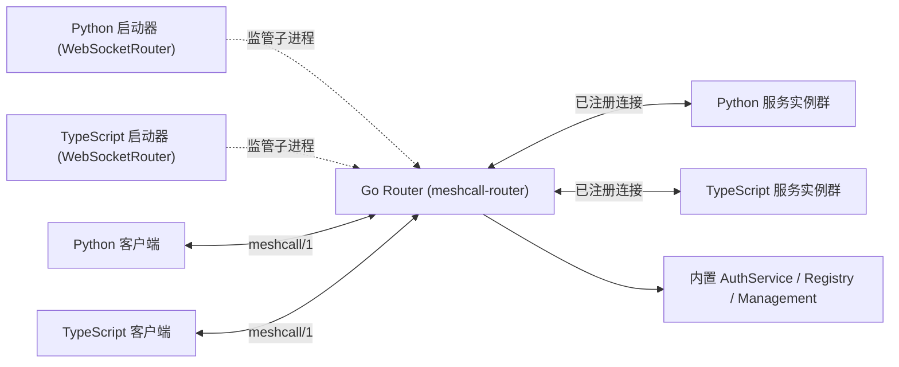

# Router 架构与鉴权指南

[English](../router.md) | **简体中文**

MeshCall 只有一套统一的 Router 实现：独立编译的 Go 可执行文件 `meshcall-router`。Python 与 TypeScript 中的 `WebSocketRouter` API 负责作为启动器（Launcher）拉起、监管和停止同一个 Go 进程，而不在各自语言内部重复维护路由表或通过 FFI 绑定。在生产环境中，Router 也可以完全独立于 Python/Node 进程单独部署。



所有客户端与服务端实例均主动向 Router 发起 WebSocket 连接（支持 TCP 与 Unix Domain Socket）。关于二进制独立运行与容器化部署，请参阅 [Go Router 部署指南](../../meshcall-router/README.zh-CN.md)。

---

## 1. 服务注册与调用路由机制

1. **HTTP 升级与身份认证**：当配置了 `--auth-file` 时，Router 会在 WebSocket HTTP Upgrade 阶段校验账号（HTTP Basic）或临时 Token（HTTP Bearer）。随后对端发送第一帧 `hello` 声明协议版本（`meshcall/1`）与角色（`client` 或 `server`），Router 校验该身份是否具备对应角色权限。
2. **服务实例注册（`server.register`）**：服务端连接发送 `server.register`，携带 `instance_id`、服务列表、方法名、调用模式（Shape）、负载均衡策略及完整的可移植契约（Contract）。
   - Router 会拒绝重复的 `instance_id`、无权限注册的服务名，以及同方法名下冲突的流模式/负载均衡策略/`targeted` 标志。
   - **支持滚动升级（按方法路由）**：同一个服务的不同实例允许注册彼此的**方法超集**。Router 会按具体方法在已注册该方法的实例集合上进行负载均衡——因此滚动发版时可以先启动包含新方法的新实例，旧实例继续正常服务已有方法，全程零中断。
   - `meshcall.router.` 前缀保留给 Router 内置服务使用。
3. **打开调用（`call.open`）**：客户端发送 `call.open`（包含 `service`、`method`、全局唯一 `call_id`、请求 `payload`、可选 `timeout_ms` / `idle_timeout_ms` / `metadata` / `idempotency_key` / `instance_id`）。Router 原样转发该帧，未知扩展字段与 `metadata` 均无损透传给目标服务实例。
4. **流周期固定绑定（Route Pinning）**：Router 校验调用权限后选定一个服务实例，并将 `(客户端连接, 服务实例连接)` 记录在 `call_id` 路由表下。**该调用后续的所有流条目（`stream.item`）、信用窗口（`stream.window`）、半关闭（`stream.end`）、取消（`call.cancel`）、结果（`call.result`）与错误（`call.error`）均严格沿此路由双向转发，绝不在中途切换实例。**
5. **路由销毁与计数回收**：当收到任一终止帧（`call.result` 或 `call.error`）时，Router 立即清理路由并将目标实例的并发计数（`inflight`）减 1。若客户端发送 `call.cancel`，Router 会立即转发取消帧并移除路由，此后该调用来自服务端的滞后帧将被直接丢弃。

Router 在内存中仅维护四张轻量表：客户端连接表、服务实例表、服务池表与活跃调用路由表。**Router 完全无状态（不落盘、不依赖外部注册中心）**，实例重连后即可自动重建全部状态。

---

## 2. 负载均衡与定向实例路由

### 负载均衡策略

| 策略 (`balance.kind`) | 选路规则 | 适用场景 |
| --- | --- | --- |
| `round_robin`（默认） | 按每个服务方法维护游标，在排序后的在线实例 ID 列表中依次轮询 | 耗时相近的无状态常规接口 |
| `least_inflight` | 优先选择当前活跃并发数（`inflight`）最少的实例；并列时按实例 ID 排序 | 耗时差异大的重计算、I/O 密集或大模型推理接口 |
| `random` | 随机选择一个在线实例 | 高吞吐、无需游标同步的简单分发 |
| `sticky` | 提取请求体中声明的字段（如 `session_id`）计算哈希并对当前实例池取模 | 优先命中同一实例内存缓存的软亲和会话 |
| `disabled` | 仅允许恰好 1 个在线实例注册该服务；超出时拒绝调用 | 单例守护任务或全局唯一协调器 |

### 定向实例调用（Targeted Calls）

每个服务实例都拥有一个唯一标识 `instance_id`（由启动参数显式指定或自动生成，可通过 `meshcall router inspect` 查看）。

- **按需点名调用**：任何 `call.open` 只要携带了 `instance_id`，Router 就会跳过负载均衡与熔断器，直接将请求发往该实例：
  - 实例未注册该服务 → 返回 `unavailable`（`reason: "instance_unknown"`，不可重试）；
  - 实例正在优雅停机排空 → 返回 `unavailable`（`reason: "instance_draining"`，可重试）；
  - 实例已达 `max_inflight` 上限 → 返回 `resource_exhausted`（`reason: "overloaded"`，可重试）。
- **强制定向服务（`targeted=True`）**：当服务每个实例持有独立状态（例如加载了不同模型的 GPU Worker、内存 Actor）时，可在定义服务时声明 `targeted=True`（Python `@service(..., targeted=True)`，TS `defineService({ targeted: true })`）：
  - 未携带 `instance_id` 的调用会在路由前被直接拒绝，返回 `invalid_argument`（`reason: "instance_required"`）；
  - 生成的 Python 与 TypeScript 客户端会将 `instance` 作为必填参数，在编译期杜绝漏传。

---

## 3. 连接管理、熔断、去重与容错边界

- **零中断优雅排空（Graceful Drain）**：服务实例停止前发送 `server.drain`，Router 立即将其从所有服务池摘除并回复 `server.drain.ack`，不再向其分配新请求，同时继续转发已建立调用的双向帧直到自然结束。Python 的 `await server.stop(drain=True)` 与 TypeScript 的 `await server.close({ drain: true })` 已内置该流程。
- **并发上限（`max_inflight`）与实例级熔断器**：
  - 实例可在注册时声明 `max_inflight`，Router 自动绕开满载实例；若所有实例均满载，则返回可重试的 `resource_exhausted`（`reason: "overloaded"`）。
  - Router 为每个实例维护独立的熔断器（默认连续失败阈值 `--breaker-threshold 5`，冷却时间 `--breaker-cooldown 10s`）。当某个实例连续触发 Router 超时或返回 `internal`/`unavailable` 达到阈值时，将被自动隔离；冷却期满后放行 1 个半开探测请求，成功则恢复，失败则重新熔断。
- **一元调用幂等去重与结果重放（`idempotency_key`）**：
  - 携带 `idempotency_key` 的一元调用按 `(service, method, idempotency_key, instance_id)` 去重：若相同 Key 的前序请求仍在执行，并发重复请求会自动合并等待同一个终止帧；若前序请求已完成，Router 会在 60 秒窗口内直接重放缓存的终止帧（最多缓存 4,096 条）。
  - 若处理该 Key 的实例中途断线（`instance_lost`），下一次携带同一 Key 的重试会自动优先选择另一个健康实例。
- **三层超时兜底**：Router 对携带 `timeout_ms` 的调用在 `timeout_ms + --deadline-grace`（默认宽限 `500ms`）处设置定时器。正常情况下服务端的超时（`timeout_ms`）会先触发；只有当服务实例假死未响应时，Router 才会介入，向客户端返回 `deadline_exceeded`（`details.source = "router"`），并向实例发送 `call.cancel` 释放路由。
- **空闲连接清理与背压队列**：客户端与服务实例默认每 15 秒发送一次协议级 `ping`；Router 对超过 `--idle-timeout`（默认 45 秒）无任何帧到达的静默连接自动关闭。每个对端连接拥有有界发送队列（最多 256 帧或至少 8 MiB），防止慢节点拖垮 Router 内存。

---

## 4. 无状态多 Router 高可用部署（Multi-Router HA）

MeshCall 不需要复杂的分布式共识（Raft/Etcd）即可实现 Router 层高可用：

直接部署多个相互独立的 `meshcall-router` 进程，并将端点列表同时配置给服务端与客户端：
- **服务端**：`WebSocketRouterServerDriver(["ws://r1:8765", "ws://r2:8765"])`（TS：`router: { endpoint: ["ws://r1:8765", "ws://r2:8765"] }`）会为每个 Router 建立独立的注册连接与重连循环，只要任意一个 Router 可用即可对外提供服务。
- **客户端**：`WebSocketClientDriver(["ws://r1:8765", "ws://r2:8765"])`（TS：`new MeshCallClient(["ws://r1:8765", "ws://r2:8765"])`）优先使用当前活跃 Router，一旦连接失败立即无缝切换到列表中的下一个 Router。

---

## 5. 账号鉴权与 ACL 权限配置

通过 `--auth-file /path/router-auth.json`（Python `auth_file=...`，TypeScript `authFile: ...`）开启鉴权。若不传该参数，Router 运行在开发模式（允许匿名连接，但禁用 Token 签发）。

```json
{
  "users": [
    {
      "username": "app",
      "password_hash": "REPLACE_WITH_HASH_PASSWORD_OUTPUT",
      "roles": ["client"],
      "call": [
        "chat.v1.ChatService/send",
        "chat.v1.ChatService/history",
        "meshcall.router.v1.AuthService/issue_token",
        "meshcall.router.v1.AuthService/revoke_token",
        "meshcall.router.v1.Registry/*"
      ]
    },
    {
      "username": "worker",
      "password_hash": "REPLACE_WITH_HASH_PASSWORD_OUTPUT",
      "roles": ["server"],
      "register": ["chat.v1.ChatService"]
    }
  ]
}
```

- 使用 `meshcall-router hash-password` 从标准输入读取密码并生成 PBKDF2-HMAC-SHA256（600,000 次迭代 + 16 字节随机盐）哈希值，Router 配置文件中绝不存储明文密码。
- `roles` 控制允许连接的角色（`client`、`server` 或两者皆可）。
- `register` 控制允许注册的服务名列表；`call` 控制允许调用的 `服务名/方法名` 列表（支持 `service/*` 通配某个服务下的全部方法，或 `*` 通配全部）。注册权限与调用权限完全正交隔离。
- 凭据通过 WebSocket 握手阶段的 HTTP `Authorization` 头传输（账号使用 `Basic`，临时 Token 使用 `Bearer`）。生产环境跨网络传输请务必配合 TLS 反向代理使用 `wss://`。

---

## 6. 内置 `Registry` 服务与 `meshcall` CLI

服务实例注册时会将自身的完整契约上报给 Router，Router 通过内置的 `meshcall.router.v1.Registry` 服务（`list` 与 `describe` 方法）对外提供查询。`meshcall` CLI 正是基于该服务构建的交互式前端：

```bash
meshcall --router ws://127.0.0.1:8765 router inspect            # 列出所有服务、实例健康度与方法签名
meshcall router inspect chat.v1.Chat --json                      # 查看单个服务的完整 JSON 契约
meshcall call chat.v1.Chat.send '{"session_id":"s1","text":"hi"}' --metadata trace=abc
meshcall call demo.v1.Counter.count '{"n":5}'                    # 服务端流：每收到一条输出一行 JSON
printf '{"value":1}\n{"value":2}\n' | meshcall call demo.v1.Sum.sum '{}' --stdin
```

---

## 7. 内置 `AuthService` 与临时范围 Token

`meshcall.router.v1.AuthService` 允许拥有权限的客户端账号动态签发短生命周期、最小权限的临时 Bearer Token：

| 方法 | 请求参数 | 所需权限 |
| --- | --- | --- |
| `whoami` | `{}` | 任何已认证的客户端身份（含临时 Token） |
| `issue_token` | `ttl_seconds` (1–3600), `scopes` | `call` 列表包含 `meshcall.router.v1.AuthService/issue_token` 的账号 |
| `revoke_token` | `token_id` | `call` 列表包含 `revoke_token` 的账号（仅可吊销自己签发的 Token） |

**安全边界**：Router 会严格校验所请求的 `scopes` 是否属于签发账号自身的权限子集（权限委托绝不能超越母账号自身权限），且临时 Token 不能再次签发或吊销其他 Token。Router 内存中仅保存 Token 的 SHA-256 摘要；一旦 Token 过期或被吊销，正在使用该 Token 的连接会被立即关闭。

**Python 签发与使用示例：**

```python
import os
from meshcall import RouterAuthClient, RouterCredentials, RouterScope
from meshcall.drivers import WebSocketClientDriver

credentials = RouterCredentials(username="app", password=os.environ["ROUTER_PASSWORD"])
async with RouterAuthClient(WebSocketClientDriver(uri, auth=credentials)) as auth:
    issued = await auth.issue_token(
        ttl_seconds=900,
        scopes=[RouterScope(service="chat.v1.ChatService", methods=["send", "history"])],
    )
    scoped_driver = WebSocketClientDriver(uri, auth=RouterCredentials(token=issued.token))
    # 将 scoped_driver 传给生成的 ChatServiceClient 使用
    # 用完后可随时吊销：
    await auth.revoke_token(issued.token_id)
```

**TypeScript 签发与使用示例：**

```typescript
import { MeshCallClient, RouterAuthClient } from "meshcall";

const issuer = new MeshCallClient(uri, undefined, {
  auth: { username: "app", password: process.env.ROUTER_PASSWORD! },
});
const auth = new RouterAuthClient(issuer);
const issued = await auth.issueToken({
  ttl_seconds: 900,
  scopes: [{ service: "chat.v1.ChatService", methods: ["send", "history"] }],
});
const scoped = new MeshCallClient(uri, undefined, { auth: { token: issued.token } });
try {
  // 直接使用 scoped 或将其传给生成的客户端
} finally {
  await scoped.close();
  await auth.revokeToken(issued.token_id);
  await issuer.close();
}
```
