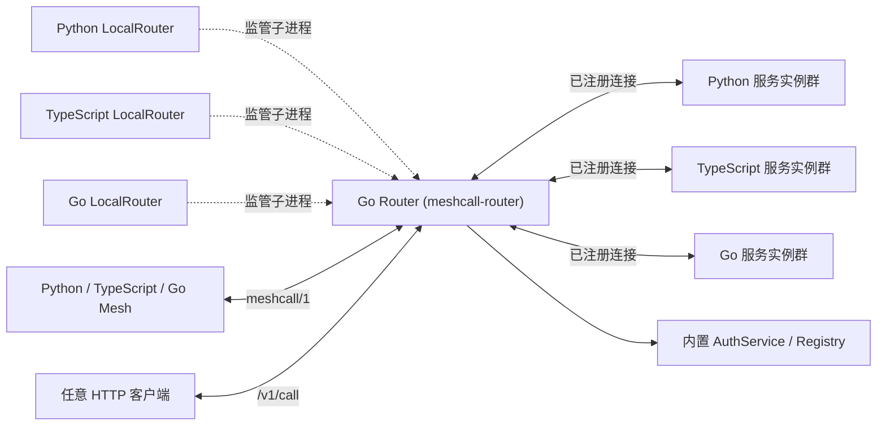

# Router 架构与鉴权指南

[English](../router.md) | **简体中文**

MeshCall 只有一套统一的 Router 实现：独立编译的 Go 可执行文件 `meshcall-router`。Python（`LocalRouter`）、TypeScript（`LocalRouter`）与 Go（`StartLocalRouter` / `NewLocalRouter`）作为启动器（Launcher）拉起、监管和停止同一个 Go 进程，而不在各自语言内部重复维护路由表或通过 FFI 绑定。在生产环境中，Router 也可以完全独立于应用进程单独部署；三种运行时编写的客户端和服务实例都通过 `Router` 与 `Mesh` 连接 Router。



所有客户端与服务端实例均主动向 Router 发起 WebSocket 连接。TCP 与本地传输（Linux、macOS、FreeBSD 上为 Unix Domain Socket，Windows 上为命名管道：`--pipe NAME`，客户端以 `pipe://NAME` 寻址）承载完全相同的逻辑帧。关于二进制独立运行与容器化部署，请参阅 [Go Router 部署指南](../../meshcall-router/README.zh-CN.md)。

---

## 1. 服务注册与调用路由机制

1. **HTTP 升级与身份认证**：当配置了鉴权文件时，Router 会在 WebSocket HTTP Upgrade 阶段校验账号（HTTP Basic）、API Key 或临时 Token（HTTP Bearer）。随后对端发送第一帧 `hello` 声明协议版本（`meshcall/1`）与角色（`client` 或 `server`），Router 校验该身份是否具备对应角色权限。
2. **服务实例注册（`server.register`）**：服务端连接发送 `server.register`，携带 `instance_id`、服务列表、方法名、调用形状（Shape）、负载均衡策略及完整的可移植契约（Contract）。
   - Router 会拒绝重复的 `instance_id`、无权限注册的服务名，以及同方法名下冲突的流形状/负载均衡策略/`targeted` 标志。
   - **支持滚动升级（按方法路由）**：同一个服务的不同实例允许注册彼此的**方法超集**。Router 会按具体方法在已注册该方法的实例集合上进行负载均衡——因此滚动发版时可以先启动包含新方法的新实例，旧实例继续正常服务已有方法，全程零中断。
   - `meshcall.router.` 前缀保留给 Router 内置服务使用。
3. **打开调用（`call.open`）**：客户端发送 `call.open`（包含 `service`、`method`、全局唯一 `call_id`、请求 `payload`、可选 `timeout_ms` / `idle_timeout_ms` / `metadata` / `idempotency_key` / `instance_id`）。Router 原样转发该帧，未知扩展字段与 `metadata` 均无损透传给目标服务实例。
4. **流周期固定绑定（Route Pinning）**：Router 校验调用权限后选定一个服务实例，并将 `(客户端连接, 服务实例连接)` 记录在 `call_id` 路由表下。**该调用后续的所有流条目（`stream.item`）、信用窗口（`stream.window`）、半关闭（`stream.end`）、取消（`call.cancel`）、结果（`call.result`）与错误（`call.error`）均严格沿此路由双向转发，绝不在中途切换实例。**
5. **路由销毁与计数回收**：当收到任一终止帧（`call.result` 或 `call.error`）时，Router 立即清理路由并将目标实例的并发计数（`inflight`）减 1。若客户端发送 `call.cancel`，Router 会立即转发取消帧并移除路由，此后该调用来自服务端的滞后帧将被直接丢弃。

Router 在内存中仅维护四张轻量表：客户端连接表、服务实例表、服务池表与活跃调用路由表。**Router 不落盘、不依赖外部注册中心**，实例重连后即可自动重建全部状态。服务池的方法集合是在线实例注册内容的并集，实例离开时随之收缩；Registry 提供见过的最完整契约，并按方法列出提供它的实例（实例只是子集时 `router inspect` 显示 `on: …`）。注册时只比较方法形状与负载均衡策略，不比较负载的 JSON Schema；负载校验由服务端与客户端运行时完成。

---

## 2. 负载均衡与定向实例路由

### 负载均衡策略

| 策略 (`balance.kind`) | 选路规则 | 适用场景 |
| --- | --- | --- |
| `round_robin`（默认） | 按每个服务方法维护游标，在排序后的在线实例 ID 列表中依次轮询 | 耗时相近的无状态常规接口 |
| `least_inflight` | 优先选择当前活跃并发数（`inflight`）最少的实例；并列时按实例 ID 排序 | 耗时差异大的重计算、I/O 密集或大模型推理接口 |
| `random` | 随机选择一个在线实例 | 高吞吐、无需游标同步的简单分发 |
| `sticky` | 对请求体中声明的字段（如 `request.session_id`）做 rendezvous（最高随机权重）哈希选择实例 | 优先命中同一实例内存缓存的软亲和会话 |
| `disabled` | 仅允许恰好 1 个在线实例注册该服务；否则拒绝调用 | 单例守护任务或全局唯一协调器 |

流只在打开时做一次负载均衡，活跃的流绝不切换实例。`sticky` 对实例 ID 使用 rendezvous 哈希：实例加入或离开时，只有它赢得或原本持有的 key 会迁移，其他 key 保持在原实例上。`inflight` 计数按实例统计，跨越其注册的所有服务。

### 定向实例调用（Targeted Calls）

每个服务实例都拥有一个唯一标识 `instance_id`（由启动参数显式指定或自动生成，可通过 `meshcall router inspect` 查看）。

- **按需点名调用**：任何 `call.open` 只要携带了 `instance_id`，Router 就会跳过负载均衡与熔断器，直接将请求发往该实例：
  - 实例未注册该服务 → 返回 `unavailable`（`reason: "instance_unknown"`，不可重试）；
  - 实例正在优雅停机排空 → 返回 `unavailable`（`reason: "instance_draining"`，可重试）；
  - 实例已达 `max_inflight` 上限 → 返回 `resource_exhausted`（`reason: "overloaded"`，可重试）。
- **强制定向服务（`targeted=True`）**：当服务每个实例持有独立状态（例如加载了不同模型的 GPU Worker、内存 Actor）时，可在定义服务时声明 `targeted=True`（Python `@service(..., targeted=True)`，TS `@service(name, { targeted: true, … })`）：
  - 未携带 `instance_id` 的调用会在路由前被直接拒绝，返回 `invalid_argument`（`reason: "instance_required"`）；所有实例必须在该标志上保持一致；
  - 生成的客户端会将 `instance` 作为必填参数，在编译期杜绝漏传；`router inspect` 将此类服务标记为 `[targeted]`，`meshcall call … --instance ID` 可点名调用。

---

## 3. 连接管理、熔断、去重与容错边界

- **零中断优雅排空（Graceful Drain）**：服务实例停止前发送 `server.drain`，Router 立即将其从所有服务池摘除并回复 `server.drain.ack`，不再向其分配新请求，同时继续转发已建立调用的双向帧直到自然结束。Python 的 `await mesh.drain()`、TypeScript 的 `await mesh.drain()` 与 Go 的 `mesh.Drain(ctx)`（以及 `mesh.run()` / `mesh.serve()` / `mesh.startServing()` 退出时）已内置该流程。
- **Router 优雅关闭**：收到 SIGTERM/SIGINT 后先排空：`/readyz` 返回 503，新连接收到 HTTP 503，新调用以可重试的 `unavailable`（`reason: "router_draining"`）失败；没有进行中调用的连接立即以 1001 关闭，其余连接在最后一个调用结束后关闭；超过 `--shutdown-timeout`（默认 10 秒，`0` 表示不等待）仍未结束的调用以可重试的 `unavailable`（`reason: "router_shutdown"`）结束，实例收到 `call.cancel`。再次收到信号则跳过等待。由 Python、TypeScript 或 Go 的 `LocalRouter` 启动器托管的 Router（启动器通过关闭 stdin 停止它）会立即结束进行中的调用；嵌入 Router 的 Go 程序调用 `Shutdown()` 或 `Close()`。详见[协议规范：Router 停机](protocol.md#router-停机router-shutdown)。
- **单连接并发上限**：每个连接最多同时进行 `--max-calls-per-connection` 个调用（默认 1000，`0` 表示不限，加入进行中幂等调用的请求也计数），超出时以可重试的 `resource_exhausted`（`reason: "overloaded"`）拒绝，连接保持不变。
- **并发上限（`max_inflight`）与实例级熔断器**：
  - 实例可在注册时声明 `max_inflight`，Router 自动绕开满载实例；若所有实例均满载，则返回可重试的 `resource_exhausted`（`reason: "overloaded"`）。
  - Router 为每个实例维护独立的熔断器（默认连续失败阈值 `--breaker-threshold 5`，冷却时间 `--breaker-cooldown 10s`）。当某个实例连续触发 Router 超时或返回 `internal`/`unavailable` 达到阈值时，将被自动隔离；冷却期满后放行 1 个半开探测请求，成功则恢复，失败则重新熔断。
- **一元调用幂等去重与结果重放（`idempotency_key`）**：
  - 携带 `idempotency_key` 的一元调用按 `(service, method, idempotency_key, instance_id)` 去重：若相同 Key 的前序请求仍在执行，并发重复请求会自动合并等待同一个终止帧；若前序请求已完成，Router 会在 60 秒窗口内直接重放缓存的终止帧（最多缓存 4,096 条；重启后丢失，这是安全的）。
  - 若处理该 Key 的实例中途断线（`instance_lost`），下一次携带同一 Key 的重试会自动优先选择另一个健康实例。
  - duplex 调用不接受幂等键，携带时返回 `invalid_argument`（`reason: "idempotency_key_on_duplex"`）。
- **断线处理**：客户端断开时，Router 取消它所有进行中的服务调用；服务实例断开时，其进行中的客户端调用以可重试的 `unavailable` 失败，是否发起新调用由调用方决定。
- **三层超时兜底**：Router 对携带 `timeout_ms` 的调用在 `timeout_ms + --deadline-grace`（默认宽限 `500ms`）处设置定时器。正常情况下服务端的超时（`timeout_ms`）会先触发；只有当服务实例假死未响应时，Router 才会介入，向客户端返回 `deadline_exceeded`（`details.source = "router"`），并向实例发送 `call.cancel` 释放路由。Router 不执行 `idle_timeout_ms`。详见[协议规范：超时](protocol.md#超时timeouts)。
- **空闲连接清理**：Router 从不发送 `ping`，只应答；客户端与服务实例默认每 15 秒发送一次协议级 `ping`，Router 对超过 `--idle-timeout`（默认 45 秒）无任何帧到达的静默连接自动关闭。
- **Router 重启**：重启会丢失注册信息与活跃路由。Router 不提供自动调用重放、流恢复、路由迁移或 Router 状态复制；被重启中断的流以可重试错误失败。

---

## 4. 无状态多 Router 高可用部署（Multi-Router HA）

MeshCall 不需要复杂的分布式共识（Raft/Etcd）即可实现 Router 层高可用：

直接部署多个相互独立的 `meshcall-router` 进程，并将端点列表传入 `Router`：Python `Router(["ws://r1:8765", "ws://r2:8765"])`、TypeScript `new Router(["ws://r1:8765", "ws://r2:8765"])`、Go `meshcall.NewRouter("ws://r1:8765", "ws://r2:8765")`，然后传给 `Mesh(router)`：
- **挂载服务时**：`Mesh` 会为列表中的每个 Router 建立独立的注册连接与重连循环，只要任意一个 Router 接受即启动成功。
- **发起客户端调用时**：`Mesh` 优先使用当前活跃 Router，一旦连接失败立即切换到列表中的下一个 Router，并在重连时从最近健康的节点恢复。

由于每个 Router 都能看到每个实例，且不持有对端无法重建的状态，Router 之间无需协调。负载均衡、去重与熔断都是按 Router 独立进行的：发往两个不同 Router 的重复幂等调用可能执行两次，遵守幂等键的 Handler 可以容忍这一点。

### 发送队列与背压

每个对端连接拥有按字节计的有界发送队列：`--outbox-size`（默认 256 MiB，不得小于 `--max-frame-size`；最大帧默认且最多 64 MiB），计入每帧编码大小与固定的每帧开销。队列不限帧数：Router 只在消费方于该调用上授予的信用（credit）内转发流条目，超出信用的条目使该调用以 `protocol_error`（`reason: "flow_control_violation"`）失败，不断开任何连接。因此同一对端上大量并发流所占的缓冲受该对端自身授予的信用约束；对端停止读取且其请求的数据超过预算时会被断开，而不是无限堆积。按调用的 FIFO 顺序保证控制帧不会越过 `call.open`；符合条件的控制帧优先发送，不同调用之间公平轮转。

---

## 5. 账号鉴权与 ACL 权限配置

通过 `--auth-file /path/router-auth.json`（Python `auth_file=...`，TypeScript `authFile: ...`）开启鉴权；也可以用 `MESHCALL_ROUTER_AUTH_FILE` 指定路径，或用 `MESHCALL_ROUTER_AUTH` 直接传入文档内容（二者只能取其一）。配置文件必须至少包含一个有效用户，格式错误或为空时启动失败。若不提供鉴权配置，Router 运行在开发模式（不开放 Token 签发）。其他每个参数也都有对应的 `MESHCALL_ROUTER_<FLAG>` 环境变量，见 [Router README：环境变量](../../meshcall-router/README.zh-CN.md#环境变量)。

```json
{
  "users": [
    {
      "username": "app",
      "password_hash": "REPLACE_WITH_HASH_PASSWORD_OUTPUT",
      "roles": ["client"],
      "call": [
        "chat.v1.ChatService/send",
        "chat.v1.ChatService/history",
        "meshcall.router.v1.AuthService/issue_token",
        "meshcall.router.v1.AuthService/revoke_token",
        "meshcall.router.v1.Registry/*"
      ]
    },
    {
      "username": "worker",
      "password_hash": "REPLACE_WITH_HASH_PASSWORD_OUTPUT",
      "roles": ["server"],
      "register": ["chat.v1.ChatService"]
    }
  ]
}
```

- 使用 `meshcall-router hash-password` 从标准输入读取密码并生成 PBKDF2-HMAC-SHA256（600,000 次迭代 + 16 字节随机盐）哈希值，Router 配置文件中绝不存储明文密码。配置只在启动时加载一次，修改账号或权限需重启 Router。
- `roles` 控制允许连接的角色（`client`、`server` 或两者皆可）。
- `register` 控制允许注册的服务名列表；`call` 控制允许调用的 `服务名/方法名` 列表（支持 `service/*` 通配某个服务下的全部方法，或 `*` 通配全部）。缺失的列表不授予任何权限。注册权限与调用权限完全正交隔离。
- 凭据通过 WebSocket 升级或 HTTP 请求的 `Authorization` 头传输：账号使用 `Basic`，临时 Token（`mt_…`）与 API Key（`mk_…`）使用 `Bearer`。绝不放在 URL 查询字符串或 `hello` 负载中。生产环境跨网络传输请务必配合 TLS 反向代理使用 `wss://`；Go 监听器自身不终结 TLS。同样的检查也适用于 Unix 套接字与命名管道；命名管道只允许 Router 自身用户、SYSTEM 与 Administrators 访问，与 Unix 套接字的文件权限效果相同。

### 连接时认证，调用时授权

- 不带任何 `Authorization` 头的连接或 HTTP 请求属于保留用户 `anonymous`，不会被拒绝。
- 提供了但无效的凭据（密码错误、Token 未知或过期、Key 错误）在升级前以 HTTP 401 拒绝，绝不降级为匿名。
- 不允许的角色或注册会以策略状态码 1008 关闭 WebSocket。
- 身份无权进行的每个调用都返回 `permission_denied`（HTTP 下为 403），无论目标是否存在、调用方是否匿名，因此无法借调用探测服务。

**`anonymous` 用户**是使用保留名的普通条目：不带 `password_hash`，`roles` 必须是 `["client"]`，没有 `register` 列表，不能签发 Token，否则启动失败。没有该条目时匿名调用方可以连接，但所有调用都会被拒绝。只有鉴权文件能决定匿名调用方可以做什么，服务无法自行声明为公开。

```json
{ "users": [
  { "username": "anonymous", "roles": ["client"], "call": ["status.v1.Health/*"] }
] }
```

`--max-anonymous-connections`（默认 1000）在 `--max-connections` 之内限制匿名 WebSocket 连接数，使匿名负载无法挤占带凭据的客户端与服务。

### API Key

API Key 是面向机器调用方（Webhook、外部服务）的长期凭据。`meshcall-router new-api-key ID` 打印一次 Key，以及应加入 `api_keys` 的条目（需自行填写 `call`）：

```json
{ "api_keys": [
  { "id": "ci-bot", "key_hash": "08bd…", "roles": ["client"], "call": ["build.v1.Jobs/*"] }
] }
```

Key 是 256 位随机串，以 SHA-256 摘要保存，因此校验只是一次哈希查找（不同于需要 PBKDF2 的密码）。它们属于配置，Router 重启后依然有效；轮换方式是先添加新 Key 再删除旧 Key。与临时 Token 一样，API Key 不能签发 Token。

成功的 Basic 校验会在内存中缓存一分钟（以凭据摘要为键，失败不缓存），同一账号的重复调用无需每次都付出 PBKDF2 的代价；缓存在重启时丢失，无害。频繁的 HTTP 调用方仍应优先使用 API Key 或 Token。浏览器无法在 WebSocket 握手上设置 `Authorization` 头，因此通过 `meshcall/web`（`new Mesh(new Router("https://…"), { token })`）走 HTTP 调用（见[第 6 节 HTTP 调用](#6-http-调用)）。Router 不直接实现 JWT 校验或外部登录系统；WebSocket 客户端与 `LocalRouter` 子进程启动器可在 Python、Node 与 Go 中运行。

---

## 6. HTTP 调用

同一监听地址在 `/v1/` 下提供 HTTP 调用（完整映射见[协议规范：HTTP 调用](protocol.md#http-调用http-calls)）。每个请求在 Router 内部作为一个短生命周期的客户端连接处理，因此经过与 WebSocket 调用相同的权限检查、负载均衡、超时、熔断、去重与定向；请求结束后 Router 不保留任何状态，关闭请求即取消调用。

```bash
curl http://127.0.0.1:8765/v1/call/demo.v1.Counter/add -d '{"a": 1, "b": 2}'
curl -N http://127.0.0.1:8765/v1/call/demo.v1.Counter/count -d '{"n": 5}'   # 若干 {"item":…} 行，最后一行 {"end":…}
curl http://127.0.0.1:8765/v1/openapi.json                                    # 你有权调用的内容的 OpenAPI 3.1 文档
printf '{"offset":0}\n{"value":1}\n{"value":2}\n' | \
  curl http://127.0.0.1:8765/v1/call/demo.v1.Sum/sum -H 'Content-Type: application/x-ndjson' --data-binary @-
meshcall call demo.v1.Counter.add '{"a": 1, "b": 2}' --http   # 通过 HTTP 调用的 CLI
```

- 鉴权与上面相同，每个请求都携带 `Authorization: Basic …` 或 `Bearer …`，失败以 JSON 错误返回。Basic 密码需要 PBKDF2 校验，且同时最多进行 8 个校验（其余返回 `503`），因此频繁调用方请使用 Token 或 API Key。
- duplex 方法返回 `405`。
- 反向代理后面请关闭客户端流的请求缓冲与服务端流的响应缓冲（nginx：`proxy_request_buffering off`、`proxy_buffering off`）；Router 在流式响应上发送 `X-Accel-Buffering: no`。
- HTTP 调用有独立的限制：`--http-default-timeout`（30 秒，作用于未带 `MeshCall-Timeout-Ms` 的一元与客户端流调用）、`--http-max-timeout`（默认无上限）与 `--http-max-inflight`（10000，超出返回 `429`）。其他源的浏览器需要 `--http-cors-origin https://app.example`（可重复）。`/healthz` 与 `/readyz` 提供存活与就绪探针。

---

## 7. 指标（Metrics）

`--metrics-listen ADDR`（`MESHCALL_ROUTER_METRICS_LISTEN`）在 `http://ADDR/metrics` 提供 Prometheus 文本格式指标。默认关闭，且始终是独立的监听地址：指标标签包含服务、方法与实例名，而公开端口不会向没有 Registry 权限的调用方透露这些信息。`router.ready` 以 `metrics` 字段报告实际绑定的地址。

| 指标 | 类型 | 标签 |
| --- | --- | --- |
| `meshcall_router_calls_total` | counter | `service`, `method`, `code`（`ok` 或错误码） |
| `meshcall_router_call_duration_seconds` | histogram | `service`, `method` |
| `meshcall_router_connections` | gauge | `role`（`client`, `server`） |
| `meshcall_router_anonymous_connections` | gauge | |
| `meshcall_router_http_inflight` | gauge | |
| `meshcall_router_routes` | gauge | |
| `meshcall_router_instance_inflight` | gauge | `service`, `instance` |
| `meshcall_router_instance_breaker_open` | gauge | `service`, `instance` |
| `meshcall_router_outbox_drops_total` | counter | |

调用在结束时计数（实例应答、客户端取消、Router 超时或随实例丢失）；在 `call.open` 时被 Router 拒绝的调用以拒绝的错误码计数。调用无人注册的服务或方法时，`service` 与 `method` 标签为空，调用方无法借此制造标签值。时长从 Router 看到 `call.open` 计到终止帧。所有指标随进程重置。

---

## 8. 内置 `Registry` 服务与 `meshcall` CLI

服务实例注册时会将自身的完整契约上报给 Router，Router 通过内置的 `meshcall.router.v1.Registry` 服务对外提供查询：`list` 返回每个服务及其实例（进行中调用数、上限、熔断状态、是否排空）与方法（形状、描述、注解、参数）；`describe {service}` 额外返回完整契约条目。开发模式下无需账号即可使用；启用账号后需要在 `call` 中包含 `meshcall.router.v1.Registry/*`，并且**只显示调用方有权调用的内容**：调用方至少能调用其中一个方法的服务才会出现，且只列出这些方法及其契约条目。描述一个无权调用的服务与描述不存在的服务返回同样的错误。

`meshcall` CLI（由 `cmd/meshcall` 构建，与 `meshcall-router` 一同发布）正是基于该服务构建的交互式前端：

```bash
meshcall --router ws://127.0.0.1:8765 router inspect            # 列出所有服务、实例健康度与方法签名
meshcall router inspect chat.v1.Chat --json                      # 查看单个服务的完整 JSON 契约
meshcall call chat.v1.Chat.send '{"session_id":"s1","text":"hi"}' --metadata trace=abc
meshcall call demo.v1.Counter.count '{"n":5}'                    # 服务端流：每收到一条输出一行 JSON
printf '{"value":1}\n{"value":2}\n' | meshcall call demo.v1.Sum.sum '{}' --stdin
```

错误输出包含错误码、消息、`details` 与修复提示：未知方法会列出可用方法，`invalid_argument` 会展示契约中的请求结构，`unavailable` 会提示使用 `router inspect`。`--json` 使每项输出（包括写到 stderr 的失败信息，带同样的 `code` / `message` / `details` / `hint` 字段）都是一行一个 JSON 文档。

`meshcall init [dir] [--force]`（也可用 `uv run meshcall init`、`npx meshcall init`）默认安装 `.agents/skills/meshcall/SKILL.md` 与 `AGENTS.md` 中带标记的 MeshCall 段落，让该项目中的编码 Agent 使用上述命令；`--agent claude|cursor|copilot|windsurf|all` 改为写入对应工具的位置（见[实战指南第 10 节](guide.md#10-ai-编程助手集成meshcall-init)）。重复执行是幂等的；被修改过的技能文件会保留，除非加 `--force`。

`meshcall generate <contract.json | module:Class> --output PATH [--language python|typescript|go] [--single-file] [--service NAME] [--package-name N] [--package-version V] [--class-name N] [--runtime-import M] [--runtime-version V] [--meshcall-requirement R]` 生成类型化的客户端包（或单个文件）；`meshcall export module:Class --output contract.json` 导出 Python 服务的契约。`module:Class` 形式的来源通过 `MESHCALL_PYTHON` 指定的解释器导出，`uv run meshcall` 会自动将其设为项目自身的解释器。Go 服务用 `meshcall.WriteContract` 导出契约，TypeScript 服务用 `writeContract`。

---

## 9. 内置 `AuthService` 与临时范围 Token

`meshcall.router.v1.AuthService` 允许拥有权限的客户端账号动态签发短生命周期、最小权限的临时 Bearer Token：

| 方法 | 请求参数 | 所需权限 |
| --- | --- | --- |
| `whoami` | `{}` | 任何已认证的客户端身份（含临时 Token） |
| `issue_token` | `ttl_seconds` (1–3600), `scopes` | `call` 列表包含 `meshcall.router.v1.AuthService/issue_token` 的账号 |
| `revoke_token` | `token_id` | `call` 列表包含 `revoke_token` 的账号（仅可吊销自己签发的 Token） |

`scopes` 中每项为 `{"service": …, "methods": [...]}`；`methods: ["*"]` 允许该服务全部方法，省略 `methods` 不授予调用权限；`register: true`（Python 为 `RouterScope(register_service=True)`）授予注册该服务的权限，适合短生命周期的 Worker。Scope 中的服务名必须是具体且不重复的，不接受命名空间通配符与 Router 保留命名空间。

**安全边界**：Router 会严格校验所请求的 `scopes` 是否属于签发账号自身的权限子集（权限委托绝不能超越母账号自身权限，超出时返回 `permission_denied`），且临时 Token 与 API Key 都不能再签发或吊销其他 Token。Router 内存中仅保存 Token 的 SHA-256 摘要，明文只在签发时返回一次；默认有效期 900 秒，最多同时存在 4096 个 Token、每个 Token 最多 128 个服务 Scope。一旦 Token 过期或被吊销，新连接将被拒绝，正在使用该 Token 的连接会被立即关闭。Token 只属于签发它的 Router 进程，Router 重启后失效，没有共享 Token 数据库或复制的 Router 状态。

**Python 签发与使用示例：**

```python
import os
from meshcall import Mesh, Router, RouterCredentials, RouterScope

credentials = RouterCredentials(username="app", password=os.environ["ROUTER_PASSWORD"])
async with Mesh(Router(uri), credentials=credentials) as issuer_mesh:
    issued = await issuer_mesh.auth.issue_token(
        scopes=[RouterScope(service="chat.v1.ChatService", methods=["send", "history"])],
        ttl_seconds=900,
    )
    async with Mesh(Router(uri), token=issued.token) as scoped_mesh:
        # 将 scoped_mesh 传给生成的客户端：ChatServiceClient(scoped_mesh)
        pass
    # 将 Token 移交给目标调用方后可随时吊销：
    await issuer_mesh.auth.revoke_token(issued.token_id)
```

**TypeScript 签发与使用示例：**

```typescript
import { Mesh, Router } from "meshcall";

await using issuerMesh = await Mesh.connect(new Router(uri), {
  credentials: { username: "app", password: process.env.ROUTER_PASSWORD! },
});
const issued = await issuerMesh.auth.issueToken(
  [{ service: "chat.v1.ChatService", methods: ["send", "history"] }],
  900,
);
await using scopedMesh = await Mesh.connect(new Router(uri), { token: issued.token });
// 将 scopedMesh 传给生成的客户端：new ChatServiceClient(scopedMesh)
await issuerMesh.auth.revokeToken(issued.token_id);
```

---

## 10. 连接服务

本地启动器（`LocalRouter`）与挂载服务实例（`Mesh`）的写法如下（Python 的 `LocalRouter` 还支持 `unix_path`、`pipe`、`max_frame_size`、`outbox_size`、`max_connections` 等选项；TypeScript 对应 `unixPath`、`pipe`、`maxFrameSize`、`outboxSize`、`maxConnections`；Go 对应 `WithUnixSocket`、`WithPipe`、`WithMaxFrameSize` 等选项）：

**Python：**

```python
async with LocalRouter(host="127.0.0.1", port=8765) as router:  # 拉起 Go Router；auth_file=... 启用账号
    mesh = Mesh(router)
    mesh.mount(MyService(), instance_id="python-1")
    async with mesh.serve():
        ...
```

**TypeScript：**

```typescript
await using router = await LocalRouter.start({ host: "127.0.0.1", port: 8765 }); // authFile 启用账号
const mesh = new Mesh(router);
mesh.mount(new MyService(), { instanceId: "typescript-1" });
await using srv = await mesh.startServing();
```

**Go：**

```go
router, err := meshcall.StartLocalRouter(ctx, meshcall.WithHost("127.0.0.1"), meshcall.WithPort(8765))
defer router.Stop()

mesh := meshcall.NewMesh(router)
mesh.Mount(&MyService{}, meshcall.WithInstanceID("go-1"))
srv, err := mesh.StartServing(ctx)
defer srv.Close()
```

连接需要鉴权的 Router 时，Python 与 TypeScript 在 `Mesh` 中传入 `token=...` 或 `credentials=RouterCredentials(...)`；Go 传入 `meshcall.WithToken(...)` 或 `meshcall.WithAuth(meshcall.BasicAuth(...))`，账号、API Key 或 Token 均可。任何语言的客户端都通过 `Mesh(Router(...))` 连接 Router 的 WebSocket 或 HTTP 地址，无需实现负载均衡或了解各个服务实例的地址。

---

## 11. 验证

无头跨语言测试套件通过生成的客户端验证全部核心调用形状、直连 TCP/本地端点、Router TCP/本地端点、多 TypeScript 实例、流固定绑定、实例断开清理、各语言启动器、跨语言签发与使用 Token、生成的 Python 客户端调用 Go 服务，以及生成的 Go 客户端调用 Python 与 TypeScript 服务：

```bash
MESHCALL_RUN_INTEROP=1 uv run --directory meshcall-py \
  pytest -q tests/test_multilang_interop.py
```

运行前请先编译 Go Router 并安装 TypeScript 运行时依赖；Go 用例需要 `go` 工具链。测试使用临时套接字与短生命周期子进程；CI 的 `interop` 任务会运行该套件。`scripts/check.sh conformance` 在 TCP 与本地传输上对 Python、TypeScript 和 Go 固件运行一致性测试套件（见[架构说明](architecture.md#一致性测试套件conformance-suite)）。
